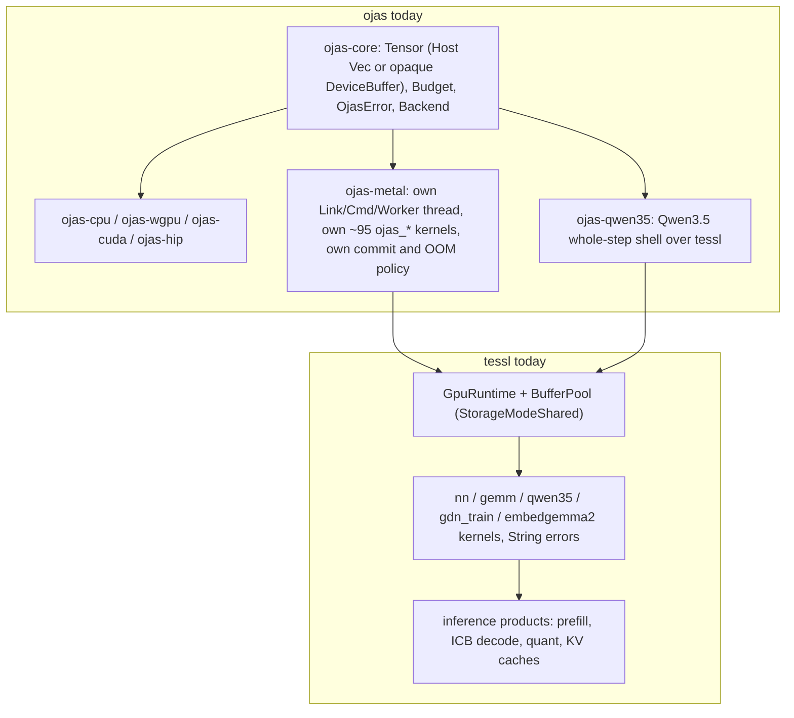
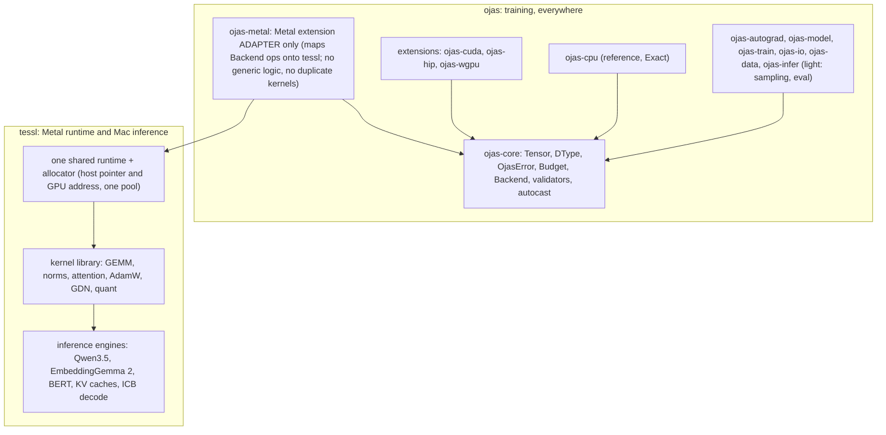
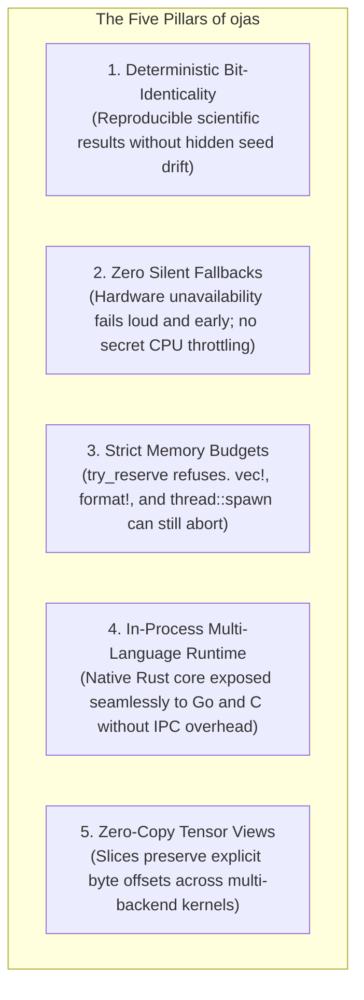
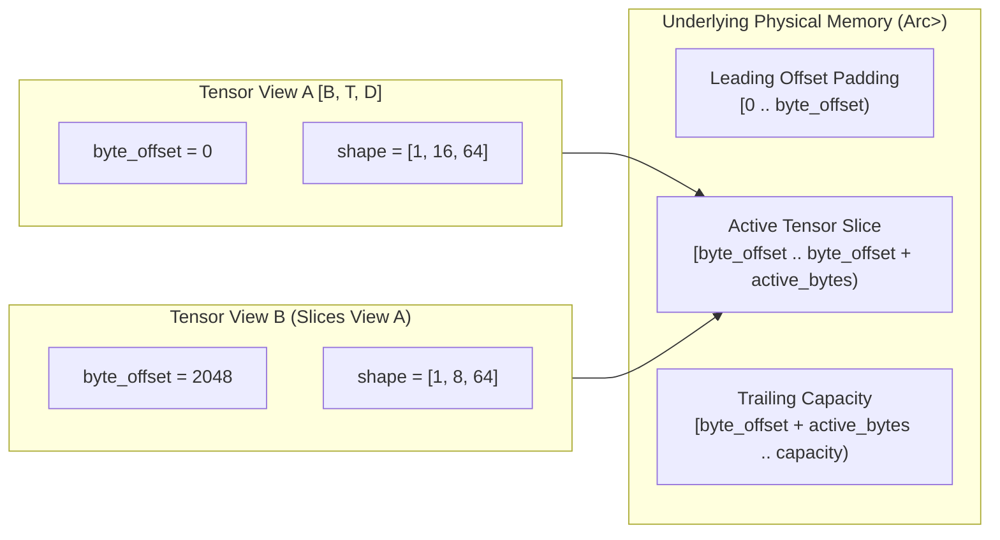
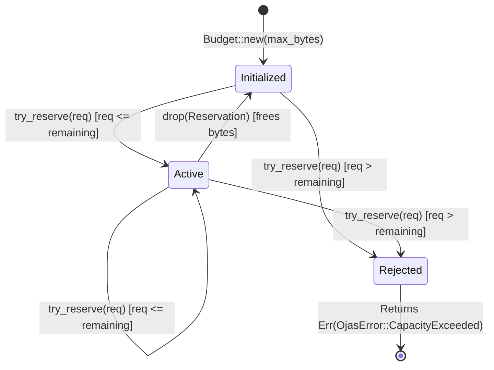
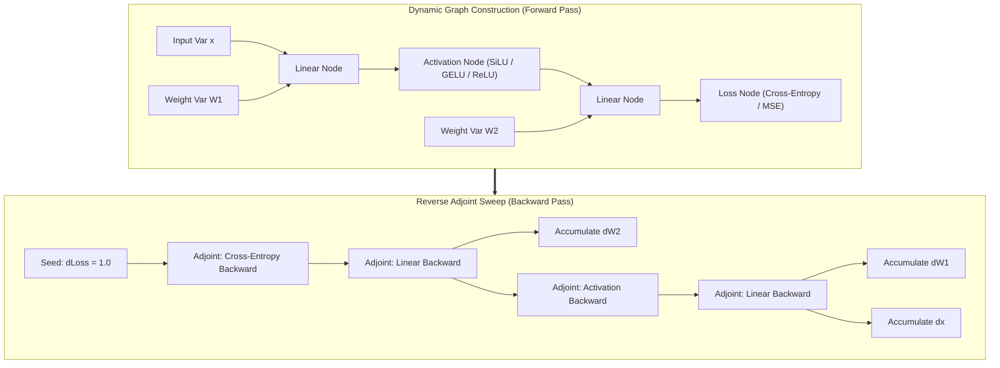
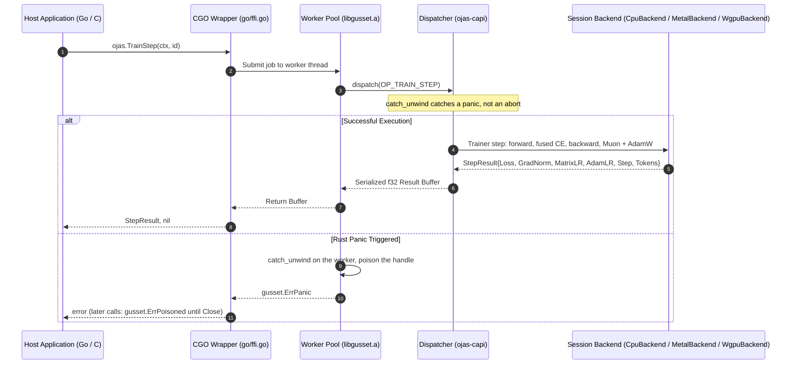
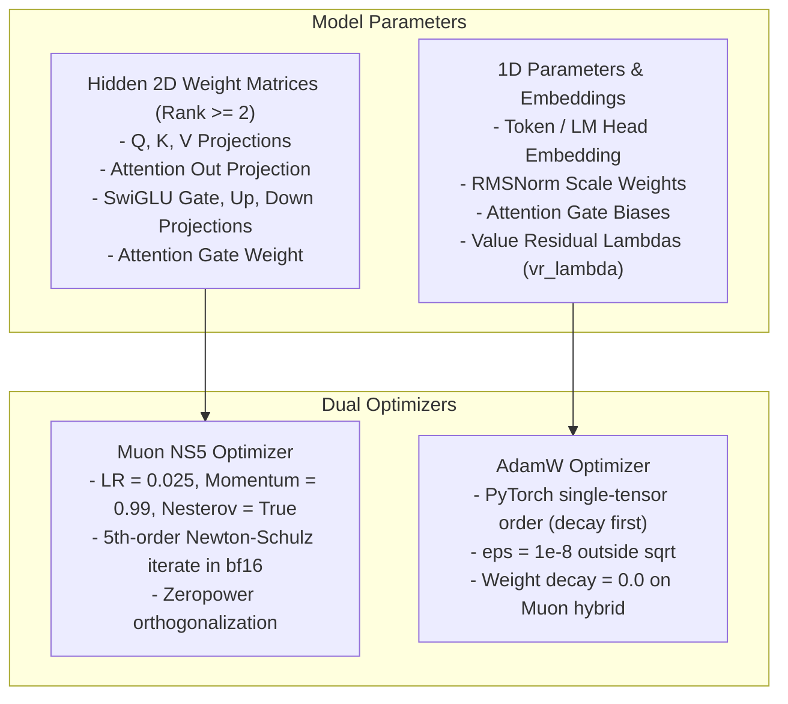

# ojas Architecture & System Design

This document specifies the technical architecture, memory model, execution graphs, and invariants of **ojas** as a modern, deterministic deep learning framework and PyTorch/TensorFlow alternative.

---

## Direction: ojas trains everywhere; tessl is the Metal extension and the Mac inference engine

> [!NOTE]
> **Status of this section.** Everything under "Target" below is the owner's direction (2026-10-31), not shipped behaviour. "Today" statements are read from the code at this commit and carry `file:line`. Nothing here changes an invariant in [`AGENTS.md`](../AGENTS.md): no silent fallback, `Numerics::Exact` stays bit-identical, budgets refuse, shapes are validated at the boundary, and library crates stay safe Rust.

**The split.** ojas is the universal, training-first framework in Rust. It owns `Tensor`, `DType`, `OjasError`, `Budget`, the `Backend` trait, the shape validators, autocast, the autograd `Tape`, optimizers, training loops, data, checkpoints, IO and the CPU backend. CUDA, HIP, wgpu and Metal plug in beneath it as extensions. ojas does light inference only (sampling and eval) and builds no second Mac inference engine.

tessl is Metal plus heavily optimized inference on the Mac. Its hand-tuned paths (Qwen3.5 prefill and decode, ICB decode, quantization, EmbeddingGemma 2, BERT, KV caches, fused kernels) are its product. It is also the Metal extension for ojas: the kernels, the runtime and the allocator that `ojas-metal` drives for training and general ops.

### Crate layers: today and target

Today, the dependency points one way (ojas to tessl, by path) and each side keeps its own foundations:

Target (direction): ojas-core holds the portable types and the one ledger; `ojas-metal` shrinks to a thin adapter over tessl; tessl keeps the Mac inference products and exports the allocator and kernel library:

The diagram is a target. Which side owns a shared leaf (a new crate under both, or `ojas-core` as a dependency of tessl) is an open decision, because tessl must keep building without an ojas checkout in its own CI and `links = "tessl"` allows one tessl source per build.

### Unified memory: single shared pool for CPU and GPU (shipped in M2)

On Apple Silicon, one authoritative root ledger (`ojas_core::Budget`) manages unified-memory allocations that carry both a host pointer and a GPU address, eliminating duplicate memory representations and bridging `tessl::SharedBuf` and `ojas-core::MappedBuffer` via `Payload::Mapped`.

- **Sole Authoritative Root Ledger (`ojas_core::Budget`):** All memory permits are requested from `Budget`. `BudgetTrimHandler` connects `tessl`'s buffer pool to the budget, automatically draining freelist caches under memory pressure before failing.
- **Zero-Copy Host/GPU Sharing (`Payload::Mapped`):** `tessl::SharedBuf` (`src/shared_buf.rs`) implements `ojas_core::MappedBuffer` (`ojas-core/src/hal.rs`) over pooled `StorageModeShared` Metal allocations. CPU threads and the Metal GPU read and write the exact same physical bytes with zero intermediate copies.
- **Fence Synchronization & Mutual Exclusion:** Host access acquires RAII leases (`HostLease` for read, `HostLeaseMut` for exclusive write). Leases synchronize with GPU completion stamps (`last_use`, `last_write`) on the `Timeline`. A GPU bind against an active host lease is refused immediately (`FenceError::Busy`).
- **Fail-Closed Placement Invariants:** Host slice accessors (`host_window`, `host_data`, `host_data_mut`) fail closed with `OjasError::Placement` when called on mapped or device tensors, preventing unmetered out-of-band CPU reads. Callers must acquire a host lease explicitly or call `.to_host(budget)`.
- **Elimination of Duplicate Code:** 3,735 lines of unverified `gpu.rs` were eliminated from `ojas-metal`, routing all Metal allocation and execution through `tessl`'s allocator under `Budget`.

### What is deliberately not duplicated

- **No generic logic in an extension.** Shape and dtype validation (`ojas_core::*_dims`), autocast, `Budget` accounting, optimizer scalar formation, the `Tape`, models and the training loop live once, in ojas. An extension only maps a `Backend` op onto its device.
- **No ojas `.metal` kernel where tessl has one.** GEMM, GDN, conv1d, gated RMS norm, encoder attention, layer norm and erf GELU are already single-sourced in tessl. The families that exist twice today (RMS norm, AdamW, softmax, argmax, reduce, residual add, embedding gather, KV write, general attention) are candidates for convergence, but they are not byte-identical: they differ in reduction order, math mode (`-fmetal-math-mode=safe` and `-ffp-contract=off` in ojas against `fast` in tessl) and fault semantics (the ojas status word and transactional apply). Removing either copy is a numerics decision that needs its own parity gate, and AdamW alone has seven implementation sites today.
- **No second Mac inference engine in ojas.** New Mac inference engines belong in tessl. `ojas-qwen35` stays a thin ojas-typed shell over tessl's Qwen3.5 step, and `ojas-infer` stays CPU sampling and eval.
- **No tessl copy of ojas types.** tessl has no `Budget`, no typed error and no `Tape`; it should not grow them. Conversely ojas does not grow Metal runtime code.

What stays separate on purpose: ojas's CPU reference and the `Numerics::Exact` contract (CPU only, never blurred with Fast-tier GPU bits), the wgpu, CUDA and HIP backends, and tessl's inference-specific kernels.

---

## 1. System Philosophy: A Modern DL Engine

ojas is architected from first principles to overcome fundamental design flaws common in legacy machine learning frameworks:

> [!IMPORTANT]
> **Radical Determinism:** Deep learning research requires exact reproducibility. ojas enforces bit-identical outputs across single-threaded CPU runs and across SIMD backends in the Exact tier, avoiding nondeterministic thread reduction tree races.
> 
> **Zero Silent Fallback Guarantee:** When an accelerator backend is selected (Metal, wgpu, CUDA, HIP), driver initialization failures produce immediate, explicit errors—**never silently falling back to host CPU execution**.

---

## 2. Framework Decomposition

ojas separates concerns into decoupled layers with unidirectional dependencies:

```mermaid
flowchart TD
    subgraph Layer5["5. Language Bindings & Client Applications"]
        GoPkg["Go API (github.com/bharathvbcr/ojas/go)"]
        RustApps["Rust Client Applications"]
        ForeignHost["C / C++ Embeddings"]
    end

    subgraph Layer4["4. In-Process Runtime & FFI Bridge"]
        Gusset["ojas-gusset-engine (Worker Pool & Ticket Management)"]
        CAPI["ojas-capi (C-ABI Engine, Session Store, Panic Boundaries)"]
    end

    subgraph Layer3["3. Models, Autograd & High-Level Primitives"]
        Infer["ojas-infer (KV Cache, Greedy and Sampled Decode, Logit Guard; CPU)"]
        Model["ojas-model (nanolab GPT written once: spec, init, Graph block, Eval, Trainer, checkpoint dir)"]
        Qwen35["ojas-qwen35 (Qwen3.5 whole-step provider over tessl; macOS Metal only; not a Backend)"]
        Autograd["ojas-autograd (Reverse-Mode Tape; uploads on GPU)"]
    end

    subgraph Layer2["2. Hardware Compute Acceleration Backends"]
        CPU["ojas-cpu (CpuBackend: Exact packed GEMM, or Fast with Accelerate)"]
        SIMD["ojas-simd (NEON GEMM, AVX2, Accelerate cblas_sgemm, vDSP / vForce)"]
        Metal["ojas-metal (MetalBackend via tessl & MSL, device-resident)"]
        WGPU["ojas-wgpu (WgpuBackend, device-resident WGSL)"]
        Kernels["ojas-kernels (Shared WGSL/CUDA sources, workgroup geometry)"]
        CUDA["ojas-cuda (CudaBackend, feature cuda; compute ops Unsupported)"]
        HIP["ojas-hip (copy probe, feature hip; not a Backend)"]
    end

    subgraph Layer1["1. Core Substrates & Data Ingestion"]
        Core["ojas-core (Tensor host & device, Layout, Budget, DType, Numerics, OjasError)"]
        Device["ojas-device (Device kinds, host probe, ResourcePolicy; no router)"]
        IO["ojas-io (Safetensors Reader/Writer, Checkpoint v1 Binary Codec)"]
        Data["ojas-data (Dataset Binary Streaming, Deterministic Counter RNG)"]
        Oracle["ojas-oracle (IEEE-754 f64 Analytical Reference Data)"]
    end

    Layer5 --> Layer4
    Layer4 --> Layer3
    Layer3 --> Layer2
    Layer2 --> Layer1
    Layer3 --> Layer1
```

Inside layer 3, `ojas-model` sits on `ojas-autograd`, `ojas-io` and `ojas-data`, and `ojas-infer` sits on `ojas-model`. `ojas-capi` depends on the model, inference, io, data, cpu, wgpu, metal and device crates. `ojas-qwen35` depends only on `ojas-core`, `ojas-io` and tessl, and is empty off macOS. The design is in [`framework-design.md`](framework-design.md).

---

## 3. General-Purpose Tensor Engine & Memory Model

### 3.1 Tensor View Model
A `Tensor` in `ojas-core` is an immutable or mutably borrowable view into typed host storage (`HostData`: `Vec<f32>` for `F32`, `Vec<u32>` for `U32`, `Vec<u16>` for `Bf16`/`F16`) or an accelerator backend's device buffer (`Arc<dyn DeviceBuffer>`). `Tensor::from_device` wraps a device buffer; `to_host` copies it back and is counted per budget tree by `Budget::device_readbacks`; `device_buffer_mut` requires sole ownership. Host accessors such as `to_f32_vec`, `f32_slice`, and `f32_slice_mut` refuse a device tensor rather than reading it back implicitly across the PCIe/memory bus.

$$\text{Element Index}(\mathbf{i}) = \text{byte\_offset} + \sum_{k=0}^{\text{rank}-1} i_k \cdot \text{strides}[k] \cdot \text{dtype.size\_bytes}()$$

> [!NOTE]
> `Tensor::narrow(dim, start, len)` creates a new zero-copy view by calculating the new `byte_offset` and updating dimensions. It never copies underlying buffer elements or causes memory fragmentation.

---

### 3.2 Memory Budgeting State Machine
All tensor allocations in `ojas` must request permits from a `Budget`. Memory cannot be silently resized, overcommitted, or swapped:

> [!IMPORTANT]
> If an allocation exceeds remaining budget limits, `try_reserve()` returns `Err(OjasError::CapacityExceeded)` immediately. The engine **refuses to silently swap to disk or resize limits**. `check_room(bytes)` allows checking capacity ahead of multi-step execution without reserving, and `peak_bytes()` / `reset_peak()` enable exact phase-by-phase peak memory measurement. Device readbacks are strictly scoped and audited per budget tree via `Budget::device_readbacks()`. On Apple Silicon Metal, `MetalBackend::set_mem_cap` and `mem_cap` allow enforcing hard device memory ceilings. Infallible system allocators (`vec!`, `format!`, `thread::spawn`) operate outside this software budget and can still abort if physical host memory is exhausted.

---

### 3.3 Unified Hardware Abstraction Layer (HAL) & Zero-Copy UMA

The vendor-neutral HAL (`ojas_core::hal`) provides the traits through which backends share memory with host CPU code without copying:
* **`MappedBuffer`:** trait extending `DeviceBuffer` representing host-visible GPU memory allocations (e.g. `StorageModeShared` on Apple Silicon). Exposes `host_ptr()`, `gpu_address()`, and safe lease-acquisition methods (`host_read()`, `host_write()`).
* **`HostLease` & `HostLeaseMut`:** RAII shared read and exclusive write borrows over a mapped buffer. Synchronizes with GPU execution timeline stamps (`last_use`, `last_write`), ensuring mutual exclusion between GPU kernels and CPU memory slices.
* **`Timeline`:** Monotonic device completion counter tracking submitted and finished sequence numbers, with poison state handling.
* **`AllocError`:** Strongly typed device allocation error enum (`OverBudget`, `Exhausted`, `TooLarge`, `InvalidAlignment`, `DeviceLost`) that converts directly to `OjasError::CapacityExceeded`.
* **`Payload::Mapped`:** Tensor storage variant that encapsulates `Arc<dyn MappedBuffer>`, bridging `tessl::SharedBuf` into the ojas tensor engine. Direct host accessors fail closed with `OjasError::Placement`.

---

## 4. Dynamic Reverse-Mode Autograd Tape

`ojas-autograd` implements a dynamic tape-based automatic differentiation engine. On a CPU backend the tensors stay as given and the cross-entropy seed is scaled on the host. On any other backend, `leaf` and the saved inputs are uploaded, reshape is a zero-copy `Tensor::view`, and the backward seed is uploaded. A non-root cross-entropy gradient is scaled with two rank-1 linears and a multiply, all on that backend.

The tape records transformer, vision/encoder, and embedding operational adjoints:
- **Core Ops:** `Tape::linear`, `Tape::rms_norm`, `Tape::silu`, `Tape::attention`, `Tape::cross_entropy`.
- **Gemma Embedding Ops:** `Tape::gelu_tanh` (exact analytical sigmoid backward in `f64`).
- **Vision & Encoder Backwards:** `Tape::layer_norm`, `Tape::channel_layer_norm` (2D LayerNorm over channels), `Tape::gelu_erf` (`gelu_erf_backward_exact`), `Tape::relu`, `Tape::linear_bias` (simultaneous $dX, dW, db$; frozen weights with `!needs_grad` bypass $dW$ GEMM computation entirely), `Tape::broadcast_add`, `Tape::broadcast_mul`, `Tape::scale`, `Tape::softmax`, `Tape::group_norm`, `Tape::bilinear`, `Tape::rope_interleaved`, `Tape::concat`, `Tape::slice`.
- **Spatial Backwards:** `Tape::conv2d`, `Tape::conv_transpose2d`, `Tape::max_pool2d` (window inverse gather).
- **Hardware Device Testing:** On macOS Metal, `tests/metal_tape.rs` runs real GPU device-resident seeded backward adjoint sweeps with zero unbudgeted readbacks.

### 4.1 Numerical Verification Oracle (`central_diff`)
Every gradient calculation is mathematically tested against an offline `f64` numerical oracle using central finite differences:

$$\frac{\partial f}{\partial x_i} \approx \frac{f(\mathbf{x} + h \mathbf{e}_i) - f(\mathbf{x} - h \mathbf{e}_i)}{2h}$$

Where $h = 10^{-5}$ in double precision (`f64`). Analytical gradients must match within specified absolute and relative tolerances (`atol`, `rtol`), otherwise tests fail fast with detailed coordinate diagnostics.

---

## 5. In-Process Multi-Language Bridge (`gusset` + `ojas-capi`)

Rather than relying on Python runtimes with global interpreter locks (GIL), `ojas` supports seamless in-process foreign language integration (e.g. Go, C):

The Go surface is `LoadModel` or `NewModel` (`DeviceCPU`, `DeviceCPUParallel`, `DeviceCPUAuto`, `DeviceMetal`, `DeviceWgpu`), `OpenTrainer`, `TrainStep`, `SaveCheckpoint` and `Resume`, `LoadTokenizer`, `Tokenize`, `Detokenize`, `DetokenizeLossy`, `TokenID`, `GenerateIDs`, `SystemProfile`, `SetMemoryCeiling`, `Free` and `Close`. The opcodes are in `ojas-capi/src/engine.rs`; the old stub step opcode (2) is retired. Every model's byte budget is a child of one process-wide ceiling (default 1 GiB, or machine hard limit `hard_memory_limit` if smaller), which `SetMemoryCeiling` raises up to physical/cgroup limits and which cannot change while a model is open. Failures cross the boundary as typed kinds (`ErrCapacity`, `ErrNonFinite`, `ErrDeviceLost`, `ErrBusy`, `ErrPoisoned`, `ErrPressure`), listed in [`go/README.md`](../go/README.md).

> [!CAUTION]
> A panic on a gusset worker is caught by `catch_unwind` and poisons the entire gusset handle: subsequent calls return `gusset.ErrPoisoned` until the handle is closed. If the panic occurred while holding the session table lock, the next lock acquisition **drops every session in the table** (`ojas-capi/src/session.rs`) to prevent corruption. Note that `catch_unwind` cannot intercept OS process aborts or stack overflows.

---

## 6. Flagship Reference Architecture: nanolab Default GPT

To validate full-stack training, `ojas` targets the 124M nanolab default GPT (12 layers, width 768, 12 heads of 64, SwiGLU 2048, vocabulary 50304, tied embedding) as its v1 vertical slice. `ojas-model` writes the model once. The `Graph` trait has one method per op, and two executors implement it: `ojas_autograd::Tape` records for training and `Eval` runs eagerly for decoding, so training and decoding share one block. Parameter names are nanolab `state_dict` keys, init is order-independent (one counter RNG per name), and `Trainer` saves and resumes a checkpoint directory. CI exercises `ModelSpec::tiny` and a 40 KB fixture; no full 124M run is recorded in [`status.md`](status.md). The block:

```mermaid
flowchart TD
    subgraph TransformerBlock["Transformer Block with Gated Attention & Value Residual"]
        In["Input x [B, T, D]"] --> PreNorm["RMSNorm (eps=1e-6)"]
        
        PreNorm --> QKV["Q, K, V Projections"]
        QKV --> RoPE["Half-Split RoPE"]
        RoPE --> QKN["RMS QK-Norm"]
        QKN --> SDPA["Causal Scaled Dot-Product Attention (scale=1/8)"]
        
        PreNorm --> Gate["Linear Gate + Bias: sigmoid(x W_g + b_g)"]
        SDPA --> GatedAttn["Per-Head Gated Attn = SDPA * Gate"]
        Gate --> GatedAttn
        
        GatedAttn --> VR["Value Residual Blend: lerp(Attn, V0, sigmoid(vr_lambda))"]
        VR --> OutProj["Linear Output Projection"]
        OutProj --> ResAdd1["Residual Add (+)"]
        In --> ResAdd1
        
        ResAdd1 --> PostNorm["RMSNorm (eps=1e-6)"]
        PostNorm --> SwiGLU["SwiGLU MLP: (x W_g) * silu(x W_up) W_down"]
        SwiGLU --> ResAdd2["Residual Add (+)"]
        ResAdd1 --> ResAdd2
    end
```

### Dual Optimizer Topology

* **Matrices ($\text{rank} \ge 2$):** Optimized via **Muon NS5** (Nesterov momentum, quintic Newton-Schulz iterate in `f32` by default in ojas, or `bf16` with `Ns5Precision::Bf16`, on CPU, Metal and wgpu; nanolab baseline runs `bf16`).
* **Vectors & Embeddings ($\text{rank} < 2$):** Optimized via **AdamW** (PyTorch single-tensor order, decay first, $\varepsilon=10^{-8}$ outside square root).

---

## 7. Web Documentation, Identity & Domain Ecosystem

### 7.1 Web Application Architecture
The site ([`site/index.html`](../site/index.html)) is one page. The labs, why, benchmarks, roadmap, and guide are sections of it:
* **Guarantee labs:** a determinism lab that sums the same float32 values with split-k and with the Exact order, plus memory budget, device refusal, panic firewall, and checked shape and view labs. Each prints the error text from the source.
* **Why ojas:** the reasons, the author's account of the defects in `docs/audit.md` that led to ojas, and what it is and is not ready for.
* **Benchmarks:** the 2026-10-02 CPU plots (block forward + backward, both recorded training-step runs, and the ops where ojas is slower) beside the scorecard tables.
* **Roadmap:** the model and trainer have landed. What is left is proof at full size, speed against PyTorch, and breadth.
* **Developer docs:** quickstart (with Rust and Go snippets compiled against this tree), core concepts, feature reference, Go API reference, architecture and crates, status and limits, and contributing rules.
* **Command palette:** `⌘K` or `/` searches the labs and every section.

### 7.2 Visual Identity (ojas)
One logo: a regular icosahedron of dark red liquid glass with a glowing core, in the same material as the LiquiTask logo. [`docs/brand/ojas-logo-source.png`](brand/ojas-logo-source.png) is the only source; [`docs/brand/render.sh`](brand/render.sh) derives the transparent logo, the tile, the favicon, touch and manifest icons, and the 1200×630 social card from it. Asset list and regeneration: [`web-and-domain.md`](web-and-domain.md#2-visual-identity-one-logo).

### 7.3 Domain Wiring & Deployment Topology
* **Canonical Domain:** [`https://ojas.vbcr.dev/`](https://ojas.vbcr.dev/) via [`site/CNAME`](../site/CNAME) and [`.github/workflows/deploy-pages.yml`](../.github/workflows/deploy-pages.yml).
* **Integrated Portfolio Route:** [`https://bharath.vbcr.dev/ojas`](https://bharath.vbcr.dev/ojas) resolved via `APP_ROUTES['ojas']` and `PROJECT_SITES['ojas']` (`p41`) in the portfolio engine.
