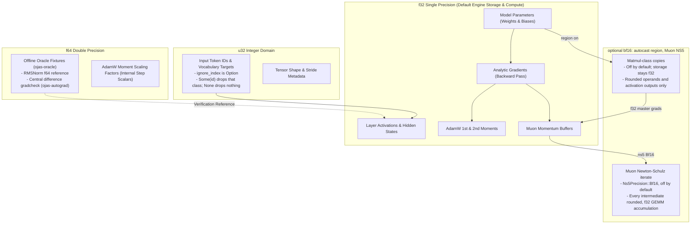
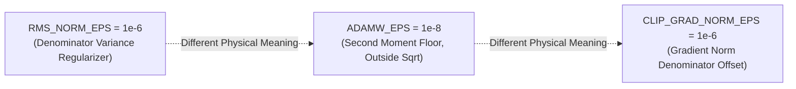

# Dtype Policy (v1)

This document formalizes numeric types, precision transitions, and epsilon constants across **ojas**.

---

## Numeric Precision Topology

---

## Tensor Data Type Matrix

| Category | Storage DType | Compute DType | Rationale & Specification |
| :--- | :--- | :--- | :--- |
| **Model Parameters** | `f32` | `f32` | Stored f32. An autocast region rounds a copy for a matmul-class op and does not rewrite the parameter. |
| **Activations** | `f32` | `f32`, or bf16-rounded inside a region | Outside a region every activation stays f32. Inside `AutocastMode::Bf16`, matmul-class outputs are rounded and tagged; RoPE, pointwise ops (GELU, ReLU, scale, broadcast add and mul, max pooling, bilinear resampling) and the residual stream stay f32 unless every counted input is already tagged; norms, softmax and embeddings stay f32 always. The SAM ops' class is listed per op in `SAM_AUTOCAST_POLICY` (`ojas-core/src/autocast.rs`) and enforced by `ojas-cpu/tests/autocast_sam_policy.rs`. |
| **Gradients** | `f32` | `f32` for master weights | Weight and bias gradients stay untagged f32. Activation gradients of matmul-class ops are rounded inside a region. |
| **Muon Momentum** | `f32` | `f32` | Standard first-moment buffer for matrix parameters. |
| **Muon Newton-Schulz** | — | `f32` by default; `bf16` with `Ns5Precision::Bf16` | `MuonNs5Config.ns5` (`TrainConfig.muon_ns5`) picks it. `F32` is nanolab with `X = G.float()`. `Bf16` is stock nanolab's `X = G.bfloat16()` as torch's eager bf16 ops run it: every intermediate rounded to bf16, GEMMs on bf16 operands accumulating in f32. CPU, Metal and wgpu implement it (wgpu since 2026-10-10, f32 GEMMs on the rounded values, held to stock nanolab's step at `TRACE_BF16_PARAM_NORMWISE_REL_TOL`). The momentum buffer and the parameter stay f32. |
| **AdamW Moments** | `f32` | `f64` (internal) | First and second moments stored as `f32`; step updates computed with `f64` scalars before casting. |
| **Tokens & Labels** | `u32` | `u32` | Accommodates vocabularies up to 50,304. `ignore_index: Option<u32>` drops rows whose target equals `Some(id)`. `None` drops nothing. |
| **Oracle Fixtures** | `f64` | `f64` | Golden reference files stored on disk; verified against CPU kernels. |

The `DType` enumeration in [`ojas-core`](../ojas-core/src/dtype.rs) defines `F32`, `Bf16`, `F16`, and `U32`. `F16` exists for checkpoint format compatibility; v1 training does not compute in `F16`. Training storage stays `F32`. `TrainConfig.autocast` defaults to off, and an off config omits the key from `to_json`, so existing run ids stay valid. `Bf16` enters an `Autocast` region around the forward, the backward and `take_grad` only. The optimizer, the loss sum and `accumulate_grad` stay outside that region. A device tensor is not downloaded to round it.

**bf16 operands (decided 2026-10-10, gp-bf16-compute-tier).** `Bf16` storage is a kernel input on the matmul-class ops only: `linear_forward`, `linear_backward`, `causal_sdpa_forward` and `causal_sdpa_backward` (its `lse` stays `F32`), the list `Backend::bf16_operands` documents. Every other op refuses `Bf16` with `OjasError::Dtype`; norms, RoPE, embeddings, the loss, the residual stream and the optimizers stay `f32`. A `Bf16` operand is widened exactly (`bits << 16`) and accumulates in `f32`, so for bf16-exact values it gives the bits of its `F32` twin under the same `Numerics`; `ojas_oracle::bf16_operands` checks that on every backend that reports `bf16_operands()`. The CPU and wgpu widen into charged scratch and run their `f32` kernels: bf16 storage over `f32` compute (Accelerate has no bf16 GEMM, WGSL has no bf16 type). Metal does the same on the device: each `Bf16` operand of those four ops is widened exactly into an `F32` copy charged to the budget for that call (`MetalBackend::widened`, `ojas-metal/src/backend.rs:364-369`; call sites `linear_forward` :1301, `linear_backward` :1327-1329, `linear_backward_input` :1359-1361, `causal_sdpa_forward` :1505, `causal_sdpa_backward` :1522-1524), and the `ExactF32` kernels run. There is no bf16 GEMM or SDPA on Metal: a resident `Bf16` weight costs 2 bytes per element, plus a 4-byte-per-element transient on every call that reads it. The tied table is the exception (`bf16_operands` doc, :1913-1919): the gather and the fused head read it in place. The committed LoRA step rows (`bench/results/2026-10-17-lora-step/rows.jsonl`) report the exact device peak and host footprint but have no column for the widening transient, so it is not separately measured. An `Autocast` region rounds its operand copies in `f32` storage on every backend (since 2026-10-11): a `Bf16` copy would only be widened back, costing 2 + 4 bytes per element instead of 4. `Bf16` reaches a kernel only when the caller holds a `Bf16` tensor. The tape keeps `f32` activations, so the tier shrinks resident `Bf16` tensors (a frozen base), not a from-scratch run's activations.

**bf16 tied table (decided 2026-10-14, ft-69744e54).** The tied embedding takes the same operand rule: the `table` of `embedding_forward` and `embedding_backward` and the `weight` of `linear_cross_entropy_mean` may be `Bf16`; their other operands stay `F32` (`U32` for ids and targets) and every output is `F32`. The lane reads the table in place: the gather widens each picked row as it copies it, `embedding_backward` reads only the table's shape (and scans its bits), and the fused head widens one `[chunk.cols, d]` vocabulary block at a time into scratch charged with its tile, never a whole-table `f32` copy (a per-call widen would put a 2.03 GB transient at the LM head at 2B, where activations peak). The CPU and Metal take it; wgpu has no table lane and refuses a `Bf16` table with `OjasError::Dtype` (`ojas_core::refuse_bf16_table`), as the validators did before. `ojas_oracle::bf16_operands` checks the table's bits, packed and at an odd element offset, over one vocabulary chunk and several, and reports `table_lane`. `qwen35::load_hf` takes the table's storage beside the linears'.

**bf16 NaN rule.** Every bf16 conversion keeps a NaN's sign and top payload bits and sets the quiet bit (`ojas_core::f32_to_bf16`, the same integer sequence in the Metal, wgpu and CUDA kernels). torch 2.13 on arm64 writes `0x7FC0` for every NaN instead; ojas keeps the payload on purpose, since the matmul-class ops refuse a NaN operand and the bits reach only casts and checkpoint writes. f16 keeps sign and payload in both. `ojas-io/tests/half_float.rs` pins it.

---

## Epsilon Constants: Never Interchangeable

ojas defines three distinct epsilon constants for numerical stability. They represent different physical quantities and must **never** be substituted for one another:

> [!IMPORTANT]
> 1. **`RMS_NORM_EPS = 1e-6`**
>    * **Formula:** $y = \frac{x}{\sqrt{\frac{1}{D}\sum x_i^2 + \varepsilon_{\text{RMS}}}} \odot w$
>    * **Source:** Matches `nanolab/mixers.py` default. Using machine epsilon (`f32::EPSILON` $\approx 1.19 \times 10^{-7}$) produces divergent activations on low-variance inputs.
> 2. **`ADAMW_EPS = 1e-8`**
>    * **Formula:** $\Delta \theta = \frac{\hat{m}}{\sqrt{\hat{v}} + \varepsilon_{\text{AdamW}}}$
>    * **Source:** Added **outside** the square root following PyTorch's single-tensor implementation (as seen in upstream tessl's `qwen35_adamw.metal`).
> 3. **`CLIP_GRAD_NORM_EPS = 1e-6`**
>    * **Formula:** $\text{scale} = \min\left(1.0, \frac{\text{max\_norm}}{\|\mathbf{g}\|_2 + \varepsilon_{\text{clip}}}\right)$
>    * **Source:** Prevents division by zero when gradients vanish without biasing positive norms.
