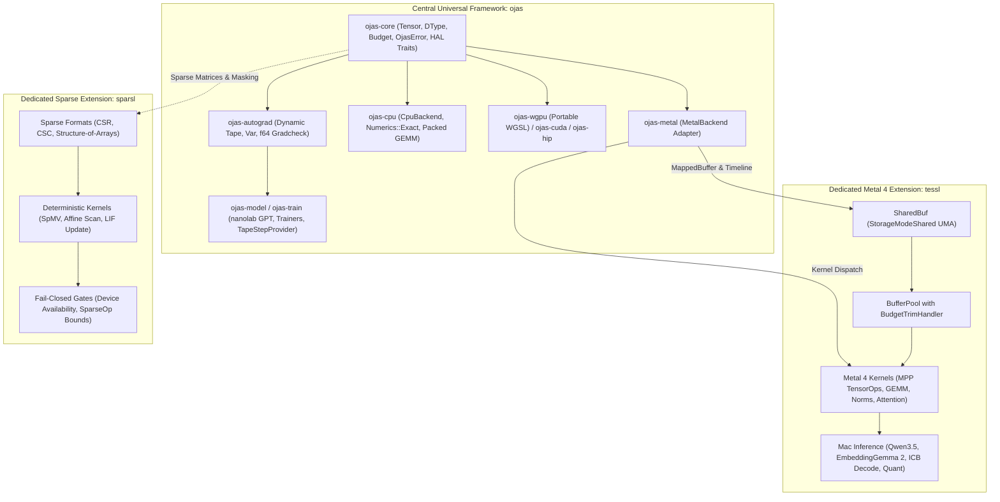

# Modular Compute Extensions Architecture

This document specifies the architecture, integration contracts, and design rationale behind **ojas** and its dedicated modular extensions: **tessl** (Apple Silicon Metal 4 acceleration and Mac inference) and **sparsl** (deterministic sparse computing and scan kernels).

---

## 1. System Topology & Ecosystem Roles

The computing ecosystem is structured into three specialized, cleanly separated checkouts:

### Role Separation Matrix

| Component | Repository | Primary Role | Target Hardware | Code Duplication Rule |
| :--- | :--- | :--- | :--- | :--- |
| **`ojas`** | `github.com/bharathvbcr/ojas` | Central universal training framework, autograd tape, budget ledger, CPU reference | Universal (x86_64, aarch64; CPU, wgpu, CUDA, Metal) | Authoritative owner of tensors, budgets, training loops, and validation contracts |
| **`tessl`** | `github.com/bharathvbcr/tessl` | Dedicated Apple Silicon / Metal 4 acceleration and high-throughput Mac inference | Apple Silicon M-series (macOS 26+, Metal 4) | Canonical source for Metal kernels (`DEP_TESSL_KERNELS`) and Mac inference engines; no generic training loops |
| **`sparsl`** | `github.com/bharathvbcr/sparsl` | Dedicated sparse computing, SpMV, and affine prefix scan substrate | Generic CPU (SIMD), optional Apple Silicon Metal | Canonical source for sparse matrix representations and scan algorithms; no dense tensor runtime duplication |

---

## 2. The Modularity Rationale

Why are `ojas`, `tessl`, and `sparsl` maintained as distinct repositories and crates rather than a single monolithic codebase?

### 1. Decoupled Compile Cycles & Toolchain Isolation
- **Toolchain Independence:** `ojas` builds with standard Rust compilers (`cargo build`) across Linux, macOS, and Windows. In contrast, `tessl` unconditionally requires the Apple Xcode Metal toolchain (`xcrun metal`, `metallib`), Metal 4 language headers (`-std=metal4.0`), and macOS Objective-C runtime bindings (`objc2`, `objc2-metal`).
- **Build Speed & CI Agility:** Forcing `ojas` to absorb `tessl` would force every Linux and Windows developer or CI agent to manage Xcode dependencies or navigate complex build-tag exclusions.
- **Verification Decoupling:** `sparsl` contains rigorous mathematical mutation campaigns and heavy property-based testing suites (`proptest`). Running these intensive fuzzing and mutation passes on every minor DL training tweak would degrade developer iteration speed.

### 2. Isolated Hardware Requirements
- **Hardware Targeting:** `tessl` targets the neural accelerators on Apple M-series chips through Metal Performance Primitives (MPP) `matmul2d` and cooperative destination registers.
- **Sparse vs. Dense Execution:** `sparsl` addresses event-driven sparse computation where matrices have 90–99% zero entries, requiring completely different memory layouts (CSR, CSC) and non-contiguous memory access patterns.
- **Portability:** `ojas` provides portable universal execution (CPU reference, wgpu WGSL for Vulkan/Metal/DX12, CUDA/HIP probes). Keeping platform-specific and domain-specific code in modular extensions prevents runtime bloat.

### 3. Independent Profiling & Micro-Benchmarking
- **Metal Tuning:** `tessl` demands register-occupancy sweeps, cooperative tile geometry tuning (`bench_gemm_sweep`, `bench_gemm_tile_tune`), and ICB command-stream replay optimization.
- **Sparsity Crossover:** `sparsl` demands crossover benchmark suites (`scan_crossover`, `spike_crossover`, `narrow_crossover`) that empirically measure the exact matrix dimension and sparsity percentage where sparse CSR formats outperform dense GEMM.
- **Training Convergence:** `ojas` focuses on end-to-end training step throughput, autograd tape overhead, optimizer step convergence, and PyTorch parity tolerances.

### 4. Independent Release Cadence & Separate Checkouts
- Downstream systems take only the components they need:
  - An event-driven simulation or spiking neural network imports `sparsl`.
  - A local Mac LLM/embedding deployment tool imports `tessl`.
  - A multi-platform training harness imports `ojas`, pulling in `ojas-metal -> tessl` or `sparsl` only when required.

---

## 3. Integration Contracts & Shared Memory Architecture

### Shared Memory Pools (Zero-Copy UMA)
On Apple Silicon, unified memory allows CPU cores and GPU execution units to access the same physical DRAM. `ojas` and `tessl` share memory with zero copies through an explicit Hardware Abstraction Layer (HAL):

1. **`ojas_core::hal::MappedBuffer` Trait:**
   Implemented by `tessl::SharedBuf` (`src/shared_buf.rs`) over pooled `StorageModeShared` allocations. Exposes a raw host pointer (`*mut u8`), a 64-bit GPU device address (`gpu_address`), and a timeline reference.
2. **`Payload::Mapped` on `Tensor`:**
   `ojas_core::Tensor` wraps `Arc<dyn MappedBuffer>`. Calling `to_host()` on a mapped tensor acquires a timeline-fenced `HostLease` over the existing memory without `memcpy`. Calling `upload()` verifies the buffer is resident in unified memory and wraps it as a device tensor without copying.
3. **Timeline Completion Fences:**
   RAII leases (`HostLease`, `HostLeaseMut`) synchronize CPU reads and writes against GPU timeline stamps (`last_use`, `last_write`). Submitting a GPU command encoder against a buffer held by a host write lease returns `FenceError::Busy` immediately.
4. **Hierarchical Budget Ledger:**
   `ojas_core::Budget` serves as the sole authoritative ledger. `tessl::BufferPool` allocates within a child budget (`pool.cache`). Under memory pressure, `BudgetTrimHandler` automatically flushes freelist caches before any allocation is refused.

### Sparse Substrate Interoperability
`sparsl` interoperates with `ojas` for structured and unstructured sparse neural network execution:
- **Sparse Recompute Masks:** `sparsl::CsrMatrix` generates boolean and integer change maps for video object tracking and attention recomputation gating (`st-gate`).
- **Gradient Pruning:** Sparse projection masks generated by `sparsl` allow `ojas-autograd` to zero or bypass inactive parameter gradient updates without dense matrix instantiation.
- **Fail-Closed Availability:** `sparsl` backends fail closed with `BackendUnavailable` if requested hardware is absent, honoring `ojas`'s core invariant of zero silent fallback.

---

## 4. Invariants Enforced Across Extensions

1. **Zero Silent Fallback:** A GPU or accelerator backend that cannot execute an operation returns an explicit error (`OjasError::Unsupported` or `BackendUnavailable`). It never quietly executes on host CPU threads.
2. **Deterministic Bit-Identicality:** Reductions under `Numerics::Exact` run in a single-threaded-order, index-increasing accumulation order, guaranteeing identical bits across machines, thread counts, and scheduling runs.
3. **Budget Governance:** Allocations must reserve space in an explicit `Budget`. Over-budget requests fail immediately with `OjasError::CapacityExceeded`.
4. **Boundary Validation:** All tensor shapes, dtypes, and sparse column bounds are validated prior to kernel dispatch or memory reservation.
5. **No Duplicate Kernels:** Metal compute kernels are single-sourced in `tessl` via `DEP_TESSL_KERNELS`; sparse representations are single-sourced in `sparsl`; autograd tape and universal training algorithms are single-sourced in `ojas`.
