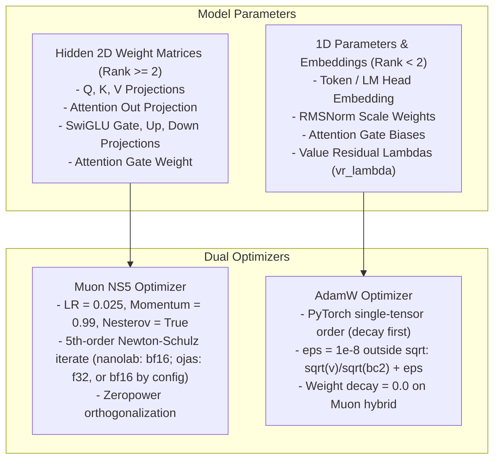
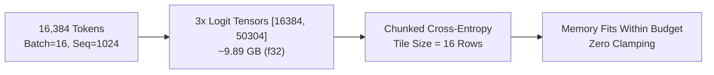

# Op Coverage — nanolab Default GPT

The v1 model is the nanolab default GPT architecture: 12 layers, hidden width $d_{\text{model}} = 768$, 12 attention heads, head dimension $d_{\text{head}} = 64$, vocabulary size 50,304, causal attention with per-head output gating and value residual connection, SwiGLU MLP, tied embedding weights, and a dual `muon_ns5_adamw` optimizer.

**Verified** at `nanolab/config.py` (`n_layer=12`, `d_model=768`, `n_head=12`, `head_dim=64`, `vocab_size=50304`, `optimizer="muon_ns5_adamw"`, `gated_attention=True`, `value_residual=True`).

---

## Transformer Block Execution Flow

```mermaid
flowchart TD
    subgraph TransformerBlock["nanolab GPT Layer Execution"]
        X["Input Activations x [B, T, D]"] --> Norm1["Pre-RMSNorm (eps = 1e-6)"]
        
        subgraph AttentionMixer["Attention Mixer"]
            Norm1 --> QProj["Linear Q: [B, T, D] -> [B, T, H, d]"]
            Norm1 --> KProj["Linear K: [B, T, D] -> [B, T, H, d]"]
            Norm1 --> VProj["Linear V: [B, T, D] -> [B, T, H, d]"]
            
            QProj --> NormQ["RMS Q-Norm"]
            KProj --> NormK["RMS K-Norm"]
            
            NormQ --> RoPEQ["Half-Split RoPE (Q)"]
            NormK --> RoPEK["Half-Split RoPE (K)"]
            
            VProj --> VR["Value Residual Blend\nv = (1 - s) v + s v0, s = sigmoid(vr_lambda)\n(layer 0 publishes v0)"]
            
            RoPEQ --> SDPA["Causal Scaled Dot-Product Attn\nscale = 1/sqrt(d_head) = 1/8"]
            RoPEK --> SDPA
            VR --> SDPA
            
            Norm1 --> Gate["Linear Gate: [B, T, D] -> [B, T, H] + Bias\nGate = sigmoid(x W_g + b_g)"]
            
            SDPA --> GatedAttn["Per-Head Gated Attention\nAttn = SDPA * Gate"]
            Gate --> GatedAttn
            
            GatedAttn --> OutProj["Linear Output Projection: [B, T, D]"]
        end
        
        OutProj --> Res1["Residual Add (+)"]
        X --> Res1
        
        subgraph MLPMixer["SwiGLU MLP Mixer"]
            Res1 --> Norm2["RMSNorm (eps = 1e-6)"]
            Norm2 --> GateUp["Linear Gate & Up Projections"]
            GateUp --> Swish["SwiGLU: silu(x W_gate) * (x W_up)"]
            Swish --> Down["Linear Down Projection"]
        end
        
        Down --> Res2["Residual Add (+)"]
        Res1 --> Res2
        
        Res2 --> NextX["Next Layer Activations [B, T, D]"]
    end
```

---

## Dual Optimizer Partitioning

> [!NOTE]
> * **Muon NS5:** nanolab runs the quintic Newton-Schulz iteration in `bf16` (`X = G.bfloat16()`). ojas runs it in `f32` by default on CPU, Metal and wgpu. With `MuonNs5Config.ns5 = Ns5Precision::Bf16` (`TrainConfig.muon_ns5`), CPU, Metal and wgpu run stock nanolab's bf16 iteration, rounding every intermediate as torch's eager bf16 ops do (wgpu since 2026-10-10, held to the same fixture at `TRACE_BF16_PARAM_NORMWISE_REL_TOL`). The CPU path is checked against one stock nanolab `Muon.step` per case (`ojas-oracle` `muon_step_bf16`) and against the stock bf16 training trace.
> * **Value residual:** nanolab blends `v` with layer 0's `v0` *before* attention: `v = (1 - s) * v + s * v0`, `s = sigmoid(vr_lambda)` (`nanolab/mixers.py`). It is not applied to the attention output.
> * **AdamW:** Follows PyTorch single-tensor order (weight decay applied before gradient update; bias correction computed; $\varepsilon = 10^{-8}$ added **outside** the square root).

---

## Op Implementation Matrix

Dtypes follow [`docs/dtype-policy.md`](dtype-policy.md). 

Each row is an op of the `Backend` trait (`ojas-core/src/backend.rs`). The Metal column names what `MetalBackend` (`ojas-metal/src/device.rs`) runs, and `ojas_*` kernels live in `ojas-metal/kernels/ojas_backend.metal`. wgpu kernels live in `ojas-kernels/src/wgsl/`. Read from source 2026-10-01; each backend's parity suite against the CPU passed in the run recorded in `docs/status.md`.

| Operation | CPU (`ojas-cpu`) | Metal (`ojas-metal`) | wgpu (`ojas-wgpu`) | DType | Specification |
| :--- | :--- | :--- | :--- | :--- | :--- |
| **Embedding** | Table lookup / scatter-add; ARM64 NEON `gather_embedding_rows_768` in `ojas-simd` | `ojas_embed_*` | WGSL | `f32`, ids `u32` | $y_t = W[x_t]$ |
| **Linear** | Packed GEMM (Exact) or SIMD/Accelerate (Fast) | tessl GEMM, `ExactF32` operands | WGSL GEMM | `f32` | $y = x W^T$, no bias |
| **RMSNorm** | Exact reduction | `ojas_rms_*` | WGSL | `f32` | $y = x / \sqrt{\overline{x^2} + 10^{-6}} \odot w$ |
| **Half-split RoPE** | Split last axis | `ojas_rope` | WGSL | `f32` | Rotate halves $(-x_2, x_1)$; layout `[B, T, H, D]` |
| **RMS QK-Norm** | Head-wise RMSNorm | `ojas_rms_*` per head | WGSL | `f32` | Applied to Q and K before RoPE (nanolab order) |
| **Permute** | Byte moves | `ojas_permute` | WGSL `layout` | `f32` | `torch.permute(x, dims).contiguous()`; rank ≤ 8 |
| **Causal SDPA** | Exact softmax; blocked above 256 positions in Fast; grouped-query; sliding window | Tiled TensorOps forward and FlashAttention-2 backward, D ≤ 256, native grouped-query, sliding window | WGSL, D ≤ 256, native grouped-query, sliding window | `f32` | $\mathrm{softmax}(QK^T/\sqrt{d} + M)V$; layout `[B, Hq, T, D]` query and `[B, Hkv, T, D]` KV; $T_q = T_k$. The forward returns the output and the row log-sum-exp `[B, Hq, T]`; the backward takes both and does not recompute the softmax. Optional window `W`: query `t` sees keys `t - W < j <= t`. Grouped-query heads read their KV head in place (no repeated K/V or summed-back gradients) |
| **Per-Head Gate** | Sigmoid broadcast | `ojas_per_head_gate_*` | WGSL | `f32` | $\sigma(x W_g^T + b_g) \odot \text{attn}$ |
| **General attention** | Exact f32 reference, row kernels shared with causal SDPA (bit-equal where the layouts overlap); deterministic across thread counts; bias gradient is its own fixed-order pass | scalar `ojas_attn_gen_fwd` (forward only; one simdgroup per query row, f32, D ≤ 256) for causal, windowed and other head dims; a non-causal call at head dim 16 or 32 runs the split-K tiled kernels `ojas_xattn_part_dD` and `ojas_xattn_combine_dD` (one thread per query row, K/V tiles in threadgroup memory, key ranges split so a short Q fills the GPU; 1.9 ms against 11.4 ms for the detector's biased cross-attention) and falls back to the scalar kernel when the budget cannot hold their partials, so the bits of a head dim 16 or 32 call can depend on the budget (the values agree to rounding); `attention_forward` (not `_saving`) of plain attention (non-causal, no window, bias or key lengths, `0 < Tq <= Tk <= 2.25 Tq`, equal head counts) at D = 32 or 64 on a TensorOps device runs tessl's tiled `encoder_attn` between permutes instead, with a shorter Q zero-padded to `Tk` rows and its output sliced (22.8 vs 606 ms at `[1, 16, 5184, 64]`; 6.1 vs 229 ms for q 5184 over 5200 keys at D 32; a refused scratch reservation runs the general kernel) | Unsupported | `f32` | `Backend::attention_forward`, `attention_forward_saving`, `attention_backward` with `AttentionOpts { causal, window, bias, key_lens }`. $\mathrm{softmax}(QK^T/\sqrt{d} + \text{bias})V$ on `[B, Hq, Tq, D]` query and `[B, Hkv, Tk, D]` KV; $T_q \ne T_k$ is allowed (cross-attention). `causal` aligns bottom-right (query `i` sits at position `i + Tk - Tq`) and composes with `window`. `bias` is `[Bb, Hb, Tqb, Tk]`, each leading extent either full or 1 (broadcast); its gradient is returned when asked for. `key_lens` is U32 `[B]`: keys `j >= lens[b]` are hidden (clamped to `Tk`; 0 hides all). A row that sees no key writes zeros and `lse = 0`. Autocast rounds q/k/v/bias to the compute dtype and leaves `lse` unrounded. `Tape::attention` records it (bias differentiable unless frozen; checkpoint replay is bit-exact on the CPU; Metal has no backward, and its saving form's kernel can depend on the budget as noted above, so the replay guarantee does not carry over to it until that is fixed) |
| **Value Residual** | Linear blend | `ojas_vres_*` | WGSL | `f32` | $(1 - s) v + s v_0$, $s = \sigma(\lambda)$, on `v` before attention |
| **SiLU, Mul** (SwiGLU) | Pointwise parallel over scoped worker threads | `ojas_silu_*`, `ojas_mul_*` | WGSL | `f32` | $\mathrm{silu}(x W_{gate}) \odot (x W_{up})$ |
| **Residual Add** | Pointwise | tessl `residual_add` | WGSL | `f32` | $x + f(x)$ |
| **Causal Conv1d + SiLU** (Qwen3.5) | Exact scalar, `ojas-cpu/src/hybrid.rs` | tessl `qwen35::conv1d_silu` / `conv1d_silu_bwd`, widths 2 to 8 | Unsupported (trait default) | `f32` | Depthwise, zero state: $y_{b,t,c} = \mathrm{silu}(\sum_{j<K} w_{c,j}\, x_{b,t+j-K+1,c})$; `[B, T, C]`, weight `[C, K]` |
| **Gated RMSNorm** (Qwen3.5) | Exact scalar, `hybrid.rs` | tessl `qwen35::gated_rms_norm` / `gated_rms_norm_bwd` (backward rows ≤ 512) | Unsupported | `f32` | $(w \odot x/\sqrt{\overline{x^2}+\epsilon}) \odot \mathrm{silu}(z)$ over the last axis (`Qwen3_5RMSNormGated`) |
| **Partial RoPE** (Qwen3.5) | Exact, `hybrid.rs`; `R = D` is Half-split RoPE bit for bit | `ojas_rope` with a rotary width | Unsupported | `f32` | Half-split rotation of the leading `R` of each head, the rest passed through; `[B, T, H, D]`, tables `[T, R]`. Text-only MRoPE tables from `ojas_core::mrope_text_tables` (the collapse) |
| **Sigmoid** (Qwen3.5) | Exact scalar, `hybrid.rs` | `ojas_sigmoid_*` | Unsupported | `f32` | $\sigma(x)$; backward $g\,\sigma(x)\,\sigma(-x)$ (no cancellation where $\sigma$ rounds to 1). The attention output gate $\text{attn} \odot \sigma(x W_{gate}^T)$ and the delta rule's $\beta$ |
| **GDN log decay** (Qwen3.5) | Exact scalar, `hybrid.rs` | `ojas_gdn_decay_*` (tessl's `qwen35_softplus`) | Unsupported | `f32` | $g = -e^{A_{\log}} \,\mathrm{softplus}(a + b_{dt})$ per head, torch's softplus threshold 20; `a` `[..., H]`, `A_log`, `dt_bias` `[H]`. The backward sums $\partial A_{\log}$ and $\partial b_{dt}$ over rows in ascending order
| **LayerNorm** (encoder) | Exact: mean and biased variance by two-pass `f64` sums, ascending, each rounded once to `f32` (a row with a mean far from zero keeps its accuracy); torch's definition | tessl `bert::layer_norm` (`eps > 0`) | Unsupported | `f32` | $(x - \mu)/\sqrt{\sigma^2 + \epsilon} \odot w + b$ over the last axis. Forward only |
| **Channel LayerNorm** (encoder) | Exact; per-position two-pass `f64` sums ascend over channels, bit-identical to LayerNorm of the permuted tensor | LayerNorm composed with two permutes | Unsupported | `f32` | SAM's `LayerNorm2d` over `[N, C, *spatial]`; `w`, `b` `[C]`. Forward only |
| **GroupNorm** (SpikeTrack pixel decoder) | Exact; each `(image, group)` row of `C / groups` channels and all positions: two-pass `f64` sums ascending, the LayerNorm arithmetic, so `groups == C` and `groups == 1` are bit-identical to LayerNorm of the matching rows; no scratch beyond the output | `ojas_gn_sum`, `ojas_gn_sq`, `ojas_gn_apply`: three passes with each row cut into up to 512/rows threadgroups, at most one per 1024 values (SAM's 8 rows of 0.66 to 2.65 million values fill the GPU; 1.0 ms at `[1, 256, 144, 144]` and 2.2 ms at 288x288 against 8.0 and 32 ms for download, CPU and upload); f32 two-pass statistics in a fixed order with the mean corrected by its residual (repeatable bit for bit, within f32 summation error of the CPU's `f64` ones, not identical; a row sum, a square or the variance that overflows f32 (a row sum past abs(x) of 3.4e38 / n, 1.3e32 at 2.65 million values a row; a square past abs(x - mean) of 1.8e19) faults where the CPU finishes); the three chunk partial arrays are charged as scratch; tessl has no group norm and `bert::layer_norm` is one threadgroup per row with a per-column affine | Unsupported | `f32` | torch's `nn.GroupNorm` over `[N, C, H, W]`; `w`, `b` `[C]`; `groups >= 1` divides `C`; `eps` finite and above 0. Autocast keeps it `f32`, as LayerNorm. Forward only |
| **GELU, erf** (encoder) | `gelu_erf_exact`: `f64` erf series, one rounding, bit-identical on every platform | tessl `bert::bias_gelu_erf` (zero bias) | Unsupported | `f32` | $0.5\,x\,(1 + \mathrm{erf}(x/\sqrt{2}))$, not the tanh form. Forward only |
| **ReLU** (DETR, memory attention) | Pointwise: `x < 0 ? 0 : x`, no arithmetic, so the bits are those of the input or `+0`; same bits on every platform | `ojas_relu_fwd` (bit-identical to the CPU) | Unsupported | `f32` | `max(x, 0)`, torch's `relu`. Forward only. In a bf16 autocast region a bf16-tagged input keeps its tag, as SiLU does |
| **Concat, Slice** (SpikeTrack memory assembly) | Copies, no arithmetic: each output value is written once and its bits are the input's; the output is the only charge; a NaN or infinity is refused as for `permute` | `ojas_concat_part` (one dispatch per input into its offset) and `ojas_slice` (the whole input scanned first, as the CPU refuses a non-finite value wherever it sits); bit-identical to the CPU, a non-finite element is a deferred fault | Unsupported | `f32` | `Backend::concat(&[&Tensor], axis)` is `torch.cat`: one rank, equal off `axis`, at least one input. `Backend::slice(input, axis, start, len)` is `narrow(axis, start, len).contiguous()`: `len >= 1`, `start + len` within the axis. Autocast adds no rounding: concat is bf16-tagged only when every input is, slice keeps its input's tag. Forward only |
| **Fill** (device constants) | One write per element into a fresh allocation; nothing is read; the output is the only charge | `ojas_fill_words` into a fresh buffer (one dispatch, no scan, nothing uploaded); bit-identical to the CPU in all three dtypes | Unsupported | `f32`, `bf16`, `u32` | `Backend::fill(shape, dtype, value)` is `torch.full`: no host buffer is uploaded. `F32` stores the value's bits, `Bf16` only a value a bf16 holds exactly and `U32` only an integer in `0..2^32` (anything else is out of range, never rounded); a NaN or infinity is refused as everywhere. Autocast adds no rounding. Forward only |
| **Linear with bias** (encoder) | `linear_forward` then one `f32` add | `linear_forward` then broadcast add | Unsupported | `f32` | $x W^T + b$, `b` `[out]`. Forward only |
| **Broadcast Add, Mul** (encoder) | One IEEE op per element; numpy broadcasting, rank ≤ 8 | `ojas_bcast_binary` | Unsupported | `f32` | Bit-identical to the CPU on Metal |
| **Scale** (encoder) | One `f32` multiply per element | `ojas_scale_fwd` | Unsupported | `f32` | `x * s`, finite `s` |
| **Softmax** (encoder) | Max-subtracted; `exp_exact` under Exact; ascending `f32` sum | `ojas_softmax_rows` (one thread per row) | Unsupported | `f32` | Last axis only; permute for another |
| **Conv2d** (SAM) | Exact `ojas-cpu/src/spatial.rs`: im2col + one GEMM per image and group (a 1x1 stride-1 convolution reads the image in place); a group with one input channel (depthwise) is a direct loop. Bias added last | `ojas_im2col`, tessl exact-f32 NT GEMM, `ojas_conv_nchw` (bias last) at any stride and padding (the im2col matrix is `batch Ho Wo x C kh kw` f32 scratch); depthwise (`groups == in == out`) on the direct kernel `ojas_dwconv`, bit-identical to the CPU; dilation above 1 and other grouped convolutions are `Unsupported` naming the configuration | Unsupported | `f32` | `[N, C, H, W]` input, PyTorch weight `[O, C/groups, kh, kw]`, optional bias `[O]`; stride, zero padding, dilation, groups. Patch embedding, 1x1, strided 3x3 and 7x7 depthwise are parameter choices. Forward only |
| **ConvTranspose2d** (SAM) | GEMM `weight^T . x`, then a gather in ascending `(kh, kw)` order | `ojas_permute` to NHWC, tessl exact-f32 NN GEMM, `ojas_convt_nchw` (bias last), for kernel == stride without padding or output padding; anything else is `Unsupported` | Unsupported | `f32` | Weight `[C, O, kh, kw]`, one group; stride, padding, output padding. Forward only |
| **MaxPool2d** (SAM) | Direct loop | Unsupported | Unsupported | `f32` | `[N, C, H, W]`, kernel and stride, no padding. Values only, no indices. Forward only |
| **Bilinear interpolate** (SAM) | Torch's source-index rule in f32 | `ojas_bilinear`: one thread per output element, taps formed in the kernel from the host's f32 axis scales (bit-identical to the CPU; no axis tables, so only the output is charged) | Unsupported | `f32` | `[N, C, H, W]` to `out_size`, `align_corners` either way, no antialiasing. Forward only |
| **Interleaved RoPE** (SAM2, SAM3) | Exact scalar | `ojas_rope` mode 2 (bit-identical to the CPU) | Unsupported | `f32` | Rotates adjacent pairs `(x[2i], x[2i+1])`, no norm; `[B, T, H, D]`, tables `[T, D/2]`. `axial_rope_2d_tables` builds the 2D axial tables (first `D/4` pairs by column, last `D/4` by row). Forward and backward |
| **Window split / merge, pixel shuffle** (SAM) | Reshape views and one `permute` (`ojas_core::{window_partition, window_merge, pixel_shuffle, pixel_unshuffle}`), on any backend that implements `permute` | `ojas_permute` | WGSL `layout` | `f32` | `[B, H, W, C]` to `[B * nW, w, w, C]`, and `[N, C*r*r, H, W]` to `[N, C, H*r, W*r]`. `H` and `W` must be multiples of the window; there is no padding |
| **Cross-Entropy** | Mean over valid targets | `ojas_ce_rows`, `ojas_ce_mean` | WGSL | `f32` | Mean NLL; `ignore_index`; all-ignored is `NonFinite`. Full `rows × vocab` logits and gradient are materialized |
| **Linear Cross-Entropy** | Tiled online softmax, stream loss/grad | Tiled stream | WGSL `loss.wgsl` | `f32` | Fused linear projection + CE loss; tiles rows/vocab without materializing full logits (`LinearCeChunk`) |
| **Grad Clip** | Global norm, f64 sum of squares | tessl `sq_norm` (`qwen35_sq_sum_pieces` + `qwen35_sum_exact_f32`: two dispatches for any number of gradients, one read per value), then `ojas_scale_multi`: 24 gradients per dispatch | WGSL `clip.wgsl` (`norm_partial`, `norm_finish`, `scale_multi`): up to 16 gradients per dispatch, as the device's binding limit allows | `f32` | Scale by $\min(1, m / (\lVert g \rVert + 10^{-6}))$. Metal norm: each 4096-value piece's squares after an exact power-of-two prescale by its max, added exactly in integers and rounded once to f64 (deterministic, finite for finite gradients). wgpu norm: each 4096-value chunk's max and its sum of $(g/\max)^2$, rescaled to the global max |
| **Accumulate Grad** | In-place add (finite check) | In-place / buffer | WGSL `accumulate` | `f32` | Accumulate step gradients into parameter gradient buffers |
| **KV Cache Write** | Slice copy at timestep | Slice copy | WGSL `kv_cache` | `f32` | Write key/value token slices into time-major decode KV cache |
| **AdamW** | Single-tensor torch order | `ojas_adamw_check` then `ojas_adamw_apply` (no copies) | WGSL `adam_check` then `adam_apply` (no copies) | `f32` | Decay first; f64 bias correction; $\varepsilon$ outside sqrt. A non-finite step writes nothing |
| **Muon NS5** | 5-step Newton-Schulz | Newton-Schulz on tessl GEMM | WGSL GEMM | `f32`, or `bf16` on CPU and Metal (nanolab: bf16) | $aX + b(XX^T)X + c(XX^T)^2X$ |

> [!WARNING]
> `MetalBackend` and `WgpuBackend` attention refuse $d_{\text{head}} > 256$ with `OjasError::UnsupportedHeadDim` (`METAL_MAX_HEAD_DIM`, and `ATTENTION_MAX_HEAD_DIM` in `ojas-kernels/src/geometry.rs` for wgpu). The tiny Metal training step in `ojas-metal/src/gpu.rs` runs tessl `flash_attn_rows` and refuses above 64. Nothing is truncated. Causal SDPA accepts grouped-query head counts.

---

## Memory Footprint at Default Micro-batch

* **Micro-batch Shape:** Batch size 16, sequence length 1024 = 16,384 tokens.
* **Unchunked Logits:** Three $16384 \times 50304$ `f32` tensors require $3 \times 16384 \times 50304 \times 4 \approx 9.89\text{ GB}$.
* **Status (Updated 2026-10-04):** Chunked / fused linear cross-entropy is implemented via `Backend::linear_cross_entropy_mean` (closing finding F9 in [`pytorch-parity-plan.md`](pytorch-parity-plan.md)). By chunking over rows and vocabulary tiles (default `LinearCeChunk { rows: 16, cols: 4096 }`) and calculating an online streaming softmax, peak memory drops from ~9.89 GB to under 50 MB for the logit chunk while accumulating parameter gradients directly. The unchunked fallback `cross_entropy_mean_forward/backward` remains available for small vocabulary / testing scenarios. The `Budget` refuses an allocation that does not fit (`CapacityExceeded`); it does not clamp.
