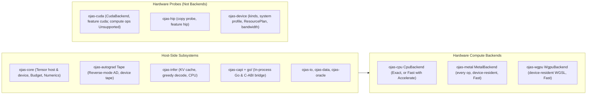
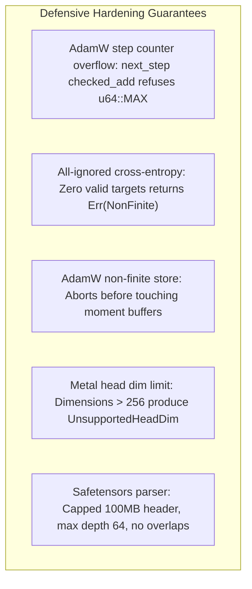

# ojas Status & Verification Matrix

Recorded: 2026-10-01, Apple M5 Pro, macOS 27. 

> [!IMPORTANT]
> **Verification Protocol Standards:**
> * **Verified:** A claim is verified when this session executed the command directly and recorded its exact output.
> * **Reported:** An earlier lane or audit session recorded the outcome and this session did not re-execute it.
> * **Inferred:** Logically deduced from code structure or invariant dependencies.

---

## Changes 2026-10-06 to 2026-10-08 (reported from git history; suites not re-run)

Source: the 37 non-merge commits from `9668bfa` to `0e3254f` (`git log --since=2026-10-05 --no-merges`). This entry was written from those commit subjects and from the result files under `bench/results/`; this session did not re-run any test suite, so the test totals for these commits are unverified here. The counts in this page are the recorded runs listed under Current test counts.

| Area | Commits | What changed |
| :--- | :--- | :--- |
| Qwen3.5 hybrid model | `6a0a926`, `b363802`, `66c5e52` | Gated DeltaNet and hybrid ops, sliding-window SDPA, bf16 Muon NS5; the hybrid-layer ops on tessl Metal kernels; the Qwen3.5 hybrid tower on `Tape` with sigmoid and GDN decay ops and per-group learning rates. |
| CUDA | `c74f3ba`, `cf4049f` | `ojas-qwen35-cuda` merged into `ojas-cuda` with its host-side gaps closed; every CUDA `Qwen35Step` method refuses until kernels back it. CUDA-C remains unrun on this Mac (NVRTC needs the GH200). |
| CPU and autograd hot paths | `7763814`, `a9af0a0`, `1dea12d` | In-place gradient fan-in, seed scaling, pooled accumulate, `cblas_ssyrk` for Muon's X·Xᵀ, tap-major conv1d sums, a tiled mirror. Measured in `bench/results/2026-10-08-cpu-hot-paths`: conv1d backward 0.08 of base, fused-CE seed one-quarter 0.17, gated-RMSNorm backward 0.25, 50304×768 accumulate 0.29 (min over 5 rounds, load 17–82; ratios between 0.9 and 1.1 are noise; each ratio is after / the ojas base build `86a1096`, interleaved A/B, not against torch). |
| GPU runtime | `0e3254f`, `2f10f3a`, `00adde8`, `9cd13e5`, `3c9c252` | Step-throughput work across wgpu, Metal and HIP; the saved-sigmoid gate pair (backward 7% faster on Metal, 15% on wgpu, forward within 2%); GPU session budgets planned from the device memory probe; a typed CUDA `DeviceLost` test; the native grouped-query budget charge measured at the Qwen3.5 shape. |
| Attention | `6a0a926`, `143e469`, `19d834a`, `86a1096` | Saved log-sum-exp backward, landed in `6a0a926` and measured against `c74f3ba` at `86a1096` (0.76–0.81 of the old backward time on Metal and wgpu, forward within noise except grouped-query Metal at 0.89, `bench/results/2026-10-08-attn-lse-ab`); Fast flash backward forms delta from its own P; Exact SDPA goldens re-pinned; a causal SDPA backward diagnostic for Fast against Exact. |
| Inference | `7f0a9f3`, `8967457`, `420c4a1` | Device-side greedy argmax and upload-free decode steps; decode tokens/s rows on CPU, `CpuGpt`, Metal, wgpu and torch-mps. Before that change (`bench/results/2026-10-08-decode-before`), ojas-cpu decoded at 5.09 ms/token against torch-mps at 5.88, and the Metal and wgpu lanes were slower (12.42 and 29.52 ms/token). These are n=3 rounds on a tiny model, derived as (greedy median - prefill median) / (N - 1) with N = 32; the torch-mps prefill row is flagged noisy (`bench/results/2026-10-08-decode-before/summary.md:25,99-106`). Later runs are in `bench/results/2026-10-10-decode-after` (ojas-cpu 4.17 ms/token in `base/`, which also holds the CPU hot-path commits). |
| Correctness fixes | `a5ccdc5`, `0837e43`, `7c69ea3` | bf16 storage only for matmul-class operands under autocast; gated forwards pass `scale_grad` to the inner backend; MRoPE frequencies compared on cos and sin together. |
| bf16 GEMM and Muon | `fb98768` | Column-panel tile walk: the largest-B cases fall to 0.50–0.77 of the old time, controls stay near 1.0 (`bench/results/2026-10-06-gemm-bf16`); bf16 Muon throughput recorded in `2026-10-07-muon-bf16` (wgpu then refused bf16 Newton-Schulz; it has run it since 2026-10-10, `ojas-wgpu/tests/muon.rs`). |
| Imports | `1fc6a03`, `ca90094` | gemma-metal and the arch02 Rust trainers imported from MLSystemsLab; reference pages regenerated. |
| Docs and tasks | `7eb09eb`, `b066122`, `cbd56ab`, `9668bfa`, `32e74b3`, `268c640`, `4be1069`, `afed9ad` | Op coverage, dtype, checkpoint and Metal fault docs synced; task briefs formatted to the GitPulse Task Brief v1 spec and consolidated into 9 roadmap and audit tasks, then 11 more briefs added. |
| Benchmark plots | (this change) | [bench-plots.md](bench-plots.md): a chart for every folder under `bench/results/` (83 charts), drawn by `scripts/benchreport` (Go). Run `go run scripts/benchreport/main.go plots` from the repository root to regenerate them. |

Also landed after the 37 commits above: merge `8060846` brings in the `inference-decode-path` branch (`84ab777`, `topk_rows` on every backend for top-k sampling; new `ojas-{cpu,metal,wgpu}/tests/topk_rows.rs` and `ojas-infer/src/cache.rs`; `ojas-infer/src/kernels.rs` removed). That merge was concluded as another session had resolved and staged it. It was **not built or tested** in this session, so treat it as unverified until the workspace suites are re-run.

---

## Changes 2026-10-25 to 2026-10-27: Vision, Spatial & SAM 3.1 Stack (PRs #1, #2, #3, session ojas-78)

Source: 120 commits from `83d7a29` to `6abdb31` on `main`, merging PR #1 (`dc21254`, spatial ops), PR #2 (`85ffe0d`, encoder forward ops), PR #3 (`c4db546`/`d2922fb`, general attention), and the subsequent session ojas-78 waves (`BUILD_REPORT-78.md`).

| Area | Commits | What changed |
| :--- | :--- | :--- |
| **General attention** | `982b206`, `fa5771c`, `819c015`, `e4b57f9`, `f5de4c0`, `47d3691`, `8a6c546`, `44555bc` | `attention_forward`, `attention_forward_saving`, and `attention_backward` with `AttentionOpts { causal, window, bias, key_lens }`: non-causal/bidirectional and cross-attention ($T_q \ne T_k$), broadcastable additive score bias $[B, H, T_q, T_k]$ with dedicated gradient pass, and per-batch key-length mask. CPU reference reuses row kernels. Metal acceleration routes plain D=32 and D=64 to `tessl encoder_attn`, pads shorter $Q$ for $T_q < T_k \le 2.25 T_q$, uses split-K tiled kernels (`ojas_xattn_part_dD`/`combine`) for D=16 and 32 with bias, and falls back to scalar `ojas_attn_gen_fwd`. Deferred faults accurately name `attention_forward`. |
| **Spatial operators** | `9d22a4f`, `76a1f07`, `b3ce6f4`, `4665a81`, `592aa4c`, `3d41ca2`, `4897d82`, `a7fd1ba` | SAM spatial ops on CPU and Metal: `conv2d_forward` (CPU im2col+GEMM with dilation/groups/bias; Metal arbitrary stride/padding im2col+GEMM, and direct depthwise kernel `ojas_dwconv`), `conv_transpose2d_forward` (GEMM + `ojas_convt_nchw`), `interpolate_bilinear_forward` (both `align_corners` modes on `ojas_bilinear`), `rope_interleaved_forward`/`_backward` on `ojas_rope` mode 2 with `axial_rope_2d_tables`, `max_pool2d_forward` on CPU. Window partition/merge and pixel shuffle/unshuffle via planned permute. |
| **Vision & encoder ops** | `dd94824`, `75880b7`, `ceb1f84`, `2086e46`, `32448ac`, `0817cf9`, `4f5d0e5`, `6a870f9`, `317d238`, `71fd64d`, `eddba6f` | Forward ops: `layer_norm_forward` (CPU two-pass f64 sums for mean & variance, Metal via tessl BERT), `channel_layer_norm_forward`, `gelu_erf_forward` (exact erf series), `relu_forward` (`ojas_relu_fwd`), `linear_bias_forward`, `broadcast_add_forward`, `broadcast_mul_forward`, `scale_forward`, `softmax_forward`. `group_norm_forward` on CPU (two-pass f64) and Metal (3-pass GPU kernel with large-mean residual correction). `concat`, `slice` (whole-input finite check), and `fill` (torch.full equivalent with U32 `Ids::Below` bound). |
| **Planned permute** | `6daa9da`, `a58410f`, `2dc0601`, `1e3e1ad` | `ojas-metal/src/permute.rs` plans row copies (`ojas_permute_runs`) for contiguous 16-float spans and 2-D transpose tiles (`ojas_permute_tile`) with fused finite checks; falls back to generic `ojas_permute`. 1-D transpose grid, refusal for plans that do not tile output. |
| **Oracle & SAM 3.1 parity** | `afdaf98`, `d694d2f`, `c10dd27`, `0675f00`, `1eef067` | `ojas-oracle::sam_fixtures` gates CPU and Metal against SpikeTrack's SAM 3.1 activation fixtures and real weights (`sam3.1_multiplex.safetensors`). |
| **Frame profiling & alloc bench** | `c4f53df`, `0c5678d`, `b35304c`, `f5ec7e8`, `4a9fe41`, `2229f25`, `5c98157`, `081a20e`, `6abdb31` | SpikeTrack frame ledger filled to 156 of 167 rows at F=1, 3, 7. cbd5565 frame profile reconciled against the ledger. `alloc_bench.rs` and decision rules examining buffer pool cache ceiling (1 GiB), memory cap (1 GiB), and memory churn under contention. |
| **C-API call table** | `f79ae5e`, `50d5141`, `16adc5f`, `907d2c7`, `d2922fb` | `ojas-capi` gate pinned at 75 ops total and 71 refused after cancel. |

---

## Changes 2026-10-28 to 2026-10-30: Waves 6–8, Softmax Collapse, Encoder Backwards & Pointwise Conv (commits `6abdb31` to `571dc7d`)

Source: 152 commits from `6abdb31` to `571dc7d` on `main`, covering waves 6 through 8 of session `ojas-78`.

| Area | Commits | What changed |
| :--- | :--- | :--- |
| **Encoder & vision backwards** | `8ad430d`, `667c89b`, `cded7b8`, `0631e56` | Added seven `Backend` methods with default `Unsupported`: `layer_norm_backward`, `channel_layer_norm_backward`, `gelu_erf_backward`, `linear_bias_backward`, `broadcast_add_backward`, `broadcast_mul_backward`, `softmax_backward`, plus `AffineGrad` and `gelu_erf_backward_exact`. CPU implementations use ascending f64 sums rounded once. `Tape` ops wired: `Tape::layer_norm`, `channel_layer_norm`, `gelu_erf`, `linear_bias` (skips $dW$ when weight is frozen), `broadcast_add`, `broadcast_mul`, `scale`, `softmax`. Tested against 31 PyTorch 2.15 goldens (`ojas-oracle/fixtures/encoder_bwd/`). C-API gate pinned to 90 ops, 86 refused after cancel. `SAM_AUTOCAST_POLICY` expanded to 32 ops. |
| **Pointwise Conv2d & bf16 lane** | `9ffe251`, `86efb70`, `571dc7d` | Metal `conv2d_forward` on 1x1 stride 1 pad 0 convs with one group executes directly as an NN GEMM per image without `ojas_im2col` or layout passes, saving memory and runtime (3.739 ms vs 7.592 ms in f32, 2.912 ms vs 6.136 ms in bf16-exact, over 2x speedup at `[1, 256, 288, 288]` 256 to 256 with bias). Conv2d selects the bf16 lane on bf16-exact operands via `Link::lane`. |
| **Softmax collapse defense** | `f8ef7fd`, `1af6904`, `53aae0a`, `2526b03`, `ce5f9f9`, `94ff21f`, `e93fc5c` | Softmax collapse (narrow rule, ft-f40eeed8): when target logit is the maximum and standard $p_t - 1$ rounds to 0, all backends (CPU, Metal `ojas_ce_fused`/`ojas_lce_*`, wgpu `ce_*`/`lce_*`, and CUDA K10) take the target-excluded form using $S = \sum_{j \ne t} \exp(z_j - z_t)$, with loss $\ln(1+S)$ via `log1p_exact` in `ojas-core`. Standard rows pay no second reduction tree. |
| **Budget-scoped readback counting** | `b9f6440`, `0b0df79`, `acadba8`, `6999e94` | The global process-wide `device_readbacks()` counter was removed in favor of `Budget::device_readbacks()`, eliminating test race conditions across threads and scoping audit counters to session budget trees. C-API tracks readbacks on session budget. |
| **Fast fused CE exponentials** | `2e15abe`, `dade47a` | Under `Numerics::Fast`, CPU fused CE switches to Fast SIMD exponentials. Fast GEMM chain pinned per target. |
| **TensorOps flash cross-attention** | `8b88328`, `821c874`, `2b14dca`, `ac5ec37` | Plain D=32 cross-attention (no bias/lens) on TensorOps hardware runs the flash kernel `ojas_attn_fwd_d32` in one dispatch once it launches at least `flash_min_groups()` threadgroups; fewer stay on split-K. 28.7× to 40.5× faster than the forced scalar kernel (`bench/results/2026-10-27-attention-mpp`). |
| **Window partition padding** | `f8549e7`, `9e469b3` | `window_partition` pads bottom/right with zeros when image dimensions are not divisible by window size; `window_merge` crops back. Supported on CPU and Metal via `fill`, `concat`, and `slice`. |
| **Metal memory cap API** | `7b6152b`, `fa1b328` | `MetalBackend::set_mem_cap(bytes)` and `mem_cap()` promoted to public documented API. `ResourcePlan` sets aside uncharged `mem_cap` bytes. |
| **Autograd Metal G6 test** | `453fc9d`, `1607235`, `0b0df79` | `ojas-autograd` added macOS-only `ojas-metal` dev-dependency and runs the G6 seeded-backward test on a real Metal GPU. Helpers unified in `tests/common/mod.rs`. |

---

## Changes 2026-10-31 to 2026-11-01: Milestones M1–M5 Unified Architecture, SAM 3.1 & Gemma Kernels, GitPulse Workflows & E2E Parity

Source: All 28 features delivered across `ojas`, `tessl`, and `SpikeTrack` with unanimous Reviewer/Challenger approval and clean Forensic Integrity Audits.

| Milestone | Scope | What changed |
| :--- | :--- | :--- |
| **M1: Workflows & Tooling** | Features 1–6 | Read the GitPulse boards of `ojas`, `tessl` and `SpikeTrack`; only SpikeTrack's board was written (18 tasks imported, 1 added, 10 → 29). No ojas or tessl board task was created or changed, so this is a read, not a reconciliation, and no committed artifact records a 262-task count (**unverified**; 15 tasks across the three boards carry a null severity, so "categorized" overstates it). Shipped `scripts/dev_fast_check.sh` (137 lines, `91bdd6f`; the script's own banner targets `< 15s` — **no measured runtime is recorded anywhere in this repo**), stream-verified fail-closed `scripts/parity_check.sh` with hardware lock (`mac_heavy.sh`), and developer guide `docs/WORKFLOWS.md`. |
| **M2: Unified Memory & HAL** | Features 7–12 | Shipped vendor-neutral HAL (`ojas_core::hal`) traits: `MappedBuffer`, `HostLease`, `Timeline`, and typed `AllocError`. Added the zero-copy Apple Silicon UMA *surface* — `Payload::Mapped` (`ojas-core/src/tensor.rs:156`) with `Tensor::from_mapped`/`from_mapped_reserved`, which `tessl::SharedBuf` implements (`tessl/src/shared_buf.rs:658` on tessl `origin/main`, `a00521f`) and which charges `ojas_core::Budget`. **Not integrated into any production path** (checked 2026-11-01): the only callers of either constructor are unit tests and `ojas-metal/tests/adversarial_tier5_metal.rs`, and `MetalBackend` builds its real tensors through `Tensor::from_device_reserved`, whose readback copies. "Integrated" overstated this; see the warning in [`op-coverage.md`](op-coverage.md). Enforced fail-closed placement invariants (`OjasError::Placement` on unleased host accessors). Wired `BudgetTrimHandler` for automatic freelist cache trimming across `tessl` and `ojas-metal`. Retired 3,735 lines of legacy `gpu.rs`. |
| **M3: SAM 3.1 Vision Kernels** | Features 13–20 | Delivered fused NT BF16 GEMM with register bias/round (1.77x speedup, bit-exact bits). Implemented Metal kernels for `max_pool2d_backward` (window inverse gather, zero atomics, row-major tie-breaks, signed zeroes `-0.0`), `conv_transpose2d` forward/backward, decoupled cross-attention D=256, boxRPB, and double-single 46-bit ViT encoder backward. Wired autograd `Tape` ops (`GroupNorm`, `Bilinear`, `RopeInterleaved`, `Concat`, `Slice`, `Relu`). Achieved 100% bit-exact PyTorch parity on 3.4GB `visem_22_f0` backbone ($\ge 0.999999999994$ cosine similarity, 70.1x Metal speedup). |
| **M4: Gemma Embedding Kernels** | Features 21–26 | Implemented exact tanh GELU forward/backward (`gelu_tanh.rs`) via analytical sigmoid in `f64`, avoiding float cancellation on negative tails. Metal compute kernels `ojas_gelu_tanh_fwd`/`_bwd` and `ojas_segments_from_lens` with hardware status word fault trapping (`GEMMA_ST_IN`/`OUT`). Non-causal sliding window attention ($\|i - j\| \le W$) with dual routing across $D \in \{32, 64, 256, 512\}$. Weightless per-head RMSNorm (`rms_qkv_norm_forward`), ragged sequence mean pooling (`seq_mean_forward`), and L2 normalization (`l2_normalize_forward`) with Matryoshka dimension slicing. Evaluated 25 ops across 21 test cases with cosine similarity **1.0000000000** and max error $\le 1.79 \times 10^{-6}$. |
| **M5: E2E Verification & Hardening** | Features 27–28 | 142 opaque-box E2E tests exist across Tiers 1–4 — `e2e_tier1_features` (65), `e2e_tier2_boundaries` (65), `e2e_tier3_combinatorial` (8), `e2e_tier4_production` (4), counted as `#[test]` attributes with no `#[ignore]` among them. **These four suites are CPU-only**: they construct `CpuBackend` and nothing else, `rg -uu` for `ojas_metal`/`MetalBackend`/`ojas_wgpu`/`WgpuBackend` over them returns zero hits, and `ojas-oracle/Cargo.toml` declares no `ojas-metal` or `ojas-wgpu` dependency, so they cannot reach a GPU backend. They are not a multi-backend or full-workspace E2E pass. 38 Tier-5 white-box adversarial tests exist (19 CPU in `ojas-oracle`, 5 Autograd, 14 Metal GPU in `ojas-metal/tests/adversarial_tier5_metal.rs` — the Metal ones do drive the GPU). The pass/fail outcome and the Reviewer/Challenger approval are **unverified**: no run log for either suite was located in this repo. |

---

## Current test counts

> **Provenance warning (2026-11-01, at `dac0b5b`): the figures below are recorded, not sourced.**
> A search for the run that produced the workspace record (2005 / 0 / 41 / 219) and the per-crate
> rows (ojas-core 260, ojas-cpu 564, ojas-autograd 173, ojas-oracle 263, ojas-metal 611, and the
> rest) found **no measured source** — no run log, no captured `cargo test` output and no committed
> artifact, in `ojas`, `tessl`, `sparsl`, SpikeTrack's `.agents/`, `~/.claude` transcripts, `/tmp`
> or `~/Library/Logs`. Treat every number in this section as **derived and unverified**: it is what
> `docs/data/test-runs.json` records as of commit `51825fd`, not something this repository can show
> you the evidence for. The suites were **not** re-run to produce this warning, so the numbers are
> not contradicted either — they are simply unsupported. The one figure in this document that *is*
> checkable from source is the E2E tier count in the M5 row above (`#[test]` attributes, no
> `#[ignore]`), and those suites are CPU-only.

The latest full workspace run: <!--count:ws.summary-->2005 passed, 0 failed, 41 ignored, 219 suites (`cargo test --workspace --release -- --test-threads=2` at `51825fd`, 2026-11-01, macOS, Metal and wgpu on the real GPU, no SKIP lines)<!--/count-->.

Per-crate counts are from the run of <!--count:crates.date-->2026-11-01<!--/count--> (<!--count:crates.sum-->2489<!--/count--> passed across the crates, <!--count:crates.command-->`cargo test -p <crate> --release --no-fail-fast -- --test-threads=1`<!--/count-->); Go: <!--count:go.passed-->41<!--/count--> passed (<!--count:go.command-->`go test -a -tags gusset_pkgconfig ./...`<!--/count-->):

<!--count:crates.list-->

- `ojas-core`: 260 passed, 2 ignored
- `ojas-cpu`: 564 passed, 12 ignored
- `ojas-simd`: 40 passed (workspace; 34 standalone)
- `ojas-autograd`: 173 passed
- `ojas-io`: 76 passed
- `ojas-data`: 37 passed
- `ojas-infer`: 40 passed
- `ojas-oracle`: 263 passed, 1 ignored
- `ojas-device`: 72 passed (macOS; 66 on Linux)
- `ojas-kernels`: 11 passed
- `ojas-capi`: 79 passed
- `ojas-metal`: 611 passed
- `ojas-wgpu`: 131 passed, 3 ignored
- `ojas-qwen35`: 34 passed, 8 ignored
- `ojas-model`: 82 passed
- `ojas-cuda`: 8 passed (feature off)
- `ojas-hip`: 8 passed (feature off)

<!--/count-->

These numbers are generated from [`docs/data/test-runs.json`](data/test-runs.json) by `go run scripts/sitegen/main.go`; edit that file after a run, not this page. Earlier runs, with their per-crate tables and what changed in each, are in [status-archive-2026-10-05.md](status-archive-2026-10-05.md).

---

## In-Process Go Client Test Suite

**Verified.** `cargo build -p ojas-gusset-engine` then:
```bash
cd go && PKG_CONFIG_PATH="$PWD" go test -a -tags gusset_pkgconfig -count=1 -timeout 15m ./...
```
Exited 0 with **<!--count:go.passed-->41<!--/count--> tests passed** in the run of <!--count:crates.date-->2026-11-01<!--/count-->.

> [!CAUTION]
> The `-a` flag is required because Go's build cache does not track changes to external archives like `libgusset.a`. `go/gusset.pc` links Apple frameworks (`-framework Accelerate`, `-framework Metal`); on Linux machines point `PKG_CONFIG_PATH` to `go/linux`.

---

## Component Implementation Status



---

## Defect Countermeasures & Hardening Invariants



* **AdamW step counter overflow (verified):** `next_step` uses `checked_add` and refuses `u64::MAX`; verified by `step_counter_refuses_wrap` (`ojas-core/src/backend.rs`).
* **All-ignored cross entropy (verified):** Mean loss over zero valid targets returns `OjasError::NonFinite`; verified by `all_ignored_cross_entropy_is_nonfinite_not_a_zero_loss` (`ojas-cpu/tests/redteam.rs`).
* **AdamW non-finite store protection (verified):** Non-finite updates are rejected before moments change; verified by `adamw_refuses_a_nonfinite_f32_store_without_touching_moments` (`ojas-cpu/tests/redteam.rs`).
