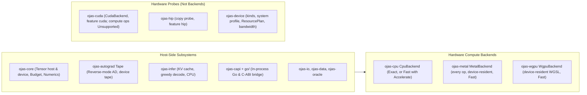
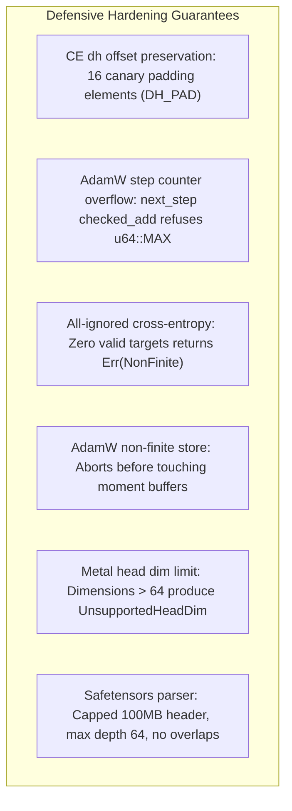

# ojas Status & Verification Matrix

Recorded: 2026-10-01, Apple M5 Pro, macOS 27. 

> [!IMPORTANT]
> **Verification Protocol Standards:**
> * **Verified:** A claim is verified when this session executed the command directly and recorded its exact output.
> * **Reported:** An earlier lane or audit session recorded the outcome and this session did not re-execute it.
> * **Inferred:** Logically deduced from code structure or invariant dependencies.

---

## Changes 2026-10-06 to 2026-10-08 (reported from git history; suites not re-run)

Source: the 37 non-merge commits from `9668bfa` to `0e3254f` (`git log --since=2026-10-05 --no-merges`). This entry was written from those commit subjects and from the result files under `bench/results/`; this session did not re-run any test suite, so the test totals for these commits are unverified here. The counts in this page are the recorded runs listed under Current test counts.

| Area | Commits | What changed |
| :--- | :--- | :--- |
| Qwen3.5 hybrid model | `6a0a926`, `b363802`, `66c5e52` | Gated DeltaNet and hybrid ops, sliding-window SDPA, bf16 Muon NS5; the hybrid-layer ops on tessl Metal kernels; the Qwen3.5 hybrid tower on `Tape` with sigmoid and GDN decay ops and per-group learning rates. |
| CUDA | `c74f3ba`, `cf4049f` | `ojas-qwen35-cuda` merged into `ojas-cuda` with its host-side gaps closed; every CUDA `Qwen35Step` method refuses until kernels back it. CUDA-C remains unrun on this Mac (NVRTC needs the GH200). |
| CPU and autograd hot paths | `7763814`, `a9af0a0`, `1dea12d` | In-place gradient fan-in, seed scaling, pooled accumulate, `cblas_ssyrk` for Muon's X·Xᵀ, tap-major conv1d sums, a tiled mirror. Measured in `bench/results/2026-10-08-cpu-hot-paths`: conv1d backward 0.08 of base, fused-CE seed one-quarter 0.17, gated-RMSNorm backward 0.25, 50304×768 accumulate 0.29 (min over 5 rounds, load 17–82; ratios between 0.9 and 1.1 are noise; each ratio is after / the ojas base build `86a1096`, interleaved A/B, not against torch). |
| GPU runtime | `0e3254f`, `2f10f3a`, `00adde8`, `9cd13e5`, `3c9c252` | Step-throughput work across wgpu, Metal and HIP; the saved-sigmoid gate pair (backward 7% faster on Metal, 15% on wgpu, forward within 2%); GPU session budgets planned from the device memory probe; a typed CUDA `DeviceLost` test; the native grouped-query budget charge measured at the Qwen3.5 shape. |
| Attention | `6a0a926`, `143e469`, `19d834a`, `86a1096` | Saved log-sum-exp backward, landed in `6a0a926` and measured against `c74f3ba` at `86a1096` (0.76–0.81 of the old backward time on Metal and wgpu, forward within noise except grouped-query Metal at 0.89, `bench/results/2026-10-08-attn-lse-ab`); Fast flash backward forms delta from its own P; Exact SDPA goldens re-pinned; a causal SDPA backward diagnostic for Fast against Exact. |
| Inference | `7f0a9f3`, `8967457`, `420c4a1` | Device-side greedy argmax and upload-free decode steps; decode tokens/s rows on CPU, `CpuGpt`, Metal, wgpu and torch-mps. Before that change (`bench/results/2026-10-08-decode-before`), ojas-cpu decoded at 5.09 ms/token against torch-mps at 5.88, and the Metal and wgpu lanes were slower (12.42 and 29.52 ms/token). These are n=3 rounds on a tiny model, derived as (greedy median - prefill median) / (N - 1) with N = 32; the torch-mps prefill row is flagged noisy (`bench/results/2026-10-08-decode-before/summary.md:25,99-106`). Later runs are in `bench/results/2026-10-10-decode-after` (ojas-cpu 4.17 ms/token in `base/`, which also holds the CPU hot-path commits). |
| Correctness fixes | `a5ccdc5`, `0837e43`, `7c69ea3` | bf16 storage only for matmul-class operands under autocast; gated forwards pass `scale_grad` to the inner backend; MRoPE frequencies compared on cos and sin together. |
| bf16 GEMM and Muon | `fb98768` | Column-panel tile walk: the largest-B cases fall to 0.50–0.77 of the old time, controls stay near 1.0 (`bench/results/2026-10-06-gemm-bf16`); bf16 Muon throughput recorded in `2026-10-07-muon-bf16` (wgpu refuses bf16 Newton-Schulz). |
| Imports | `1fc6a03`, `ca90094` | gemma-metal and the arch02 Rust trainers imported from MLSystemsLab; reference pages regenerated. |
| Docs and tasks | `7eb09eb`, `b066122`, `cbd56ab`, `9668bfa`, `32e74b3`, `268c640`, `4be1069`, `afed9ad` | Op coverage, dtype, checkpoint and Metal fault docs synced; task briefs formatted to the GitPulse Task Brief v1 spec and consolidated into 9 roadmap and audit tasks, then 11 more briefs added. |
| Benchmark plots | (this change) | [bench-plots.md](bench-plots.md): a chart for every folder under `bench/results/` (83 charts), drawn by `scripts/benchreport` (Go). Run `go run scripts/benchreport/main.go plots` from the repository root to regenerate them. |

Also landed after the 37 commits above: merge `8060846` brings in the `inference-decode-path` branch (`84ab777`, `topk_rows` on every backend for top-k sampling; new `ojas-{cpu,metal,wgpu}/tests/topk_rows.rs` and `ojas-infer/src/cache.rs`; `ojas-infer/src/kernels.rs` removed). That merge was concluded as another session had resolved and staged it. It was **not built or tested** in this session, so treat it as unverified until the workspace suites are re-run.

---

## Current test counts

The latest full workspace run: <!--count:ws.summary-->1825 passed, 0 failed, 41 ignored, 211 suites (`cargo test --workspace --release -- --test-threads=2` at `d431949`, 2026-10-09, macOS, Metal and wgpu on the real GPU, no SKIP lines)<!--/count-->.

Per-crate counts are from the run of <!--count:crates.date-->2026-10-05<!--/count--> (<!--count:crates.sum-->1347<!--/count--> passed across the crates, <!--count:crates.command-->`cargo test -p <crate> --release --no-fail-fast -- --test-threads=1`<!--/count-->); Go: <!--count:go.passed-->41<!--/count--> passed (<!--count:go.command-->`go test -a -tags gusset_pkgconfig ./...`<!--/count-->):

<!--count:crates.list-->

- `ojas-core`: 154 passed, 2 ignored
- `ojas-cpu`: 291 passed, 12 ignored
- `ojas-simd`: 40 passed (workspace; 34 standalone)
- `ojas-autograd`: 68 passed
- `ojas-io`: 76 passed
- `ojas-data`: 37 passed
- `ojas-infer`: 40 passed
- `ojas-oracle`: 41 passed, 1 ignored
- `ojas-device`: 72 passed (macOS; 66 on Linux)
- `ojas-kernels`: 11 passed
- `ojas-capi`: 79 passed
- `ojas-metal`: 175 passed
- `ojas-wgpu`: 131 passed, 3 ignored
- `ojas-qwen35`: 34 passed, 8 ignored
- `ojas-model`: 82 passed
- `ojas-cuda`: 8 passed (feature off)
- `ojas-hip`: 8 passed (feature off)

<!--/count-->

These numbers are generated from [`docs/data/test-runs.json`](data/test-runs.json) by `go run scripts/sitegen/main.go`; edit that file after a run, not this page. Earlier runs, with their per-crate tables and what changed in each, are in [status-archive-2026-10-05.md](status-archive-2026-10-05.md).

---

## In-Process Go Client Test Suite

**Verified.** `cargo build -p ojas-gusset-engine` then:
```bash
cd go && PKG_CONFIG_PATH="$PWD" go test -a -tags gusset_pkgconfig -count=1 -timeout 15m ./...
```
Exited 0 with **<!--count:go.passed-->41<!--/count--> tests passed** in the run of <!--count:crates.date-->2026-10-05<!--/count-->.

> [!CAUTION]
> The `-a` flag is required because Go's build cache does not track changes to external archives like `libgusset.a`. `go/gusset.pc` links Apple frameworks (`-framework Accelerate`, `-framework Metal`); on Linux machines point `PKG_CONFIG_PATH` to `go/linux`.

---

## Component Implementation Status



---

## Defect Countermeasures & Hardening Invariants



* **CE `dh` offset preservation (verified):** `ojas-metal` reserves 16 canary padding elements (`DH_PAD`) before the `dh` slice; verified by `ce_nonzero_dh_offset_keeps_prefix` (`ojas-metal/src/gpu.rs`).
* **AdamW step counter overflow (verified):** `next_step` uses `checked_add` and refuses `u64::MAX`; verified by `step_count_at_u64_max_is_refused` (`ojas-metal/src/gpu.rs`).
* **All-ignored cross entropy (verified):** Mean loss over zero valid targets returns `OjasError::NonFinite`; verified by `all_ignored_cross_entropy_is_nonfinite_not_a_zero_loss` (`ojas-cpu/tests/redteam.rs`).
* **AdamW non-finite store protection (verified):** Non-finite updates are rejected before moments change; verified by `adamw_refuses_a_nonfinite_f32_store_without_touching_moments` (`ojas-cpu/tests/redteam.rs`).
