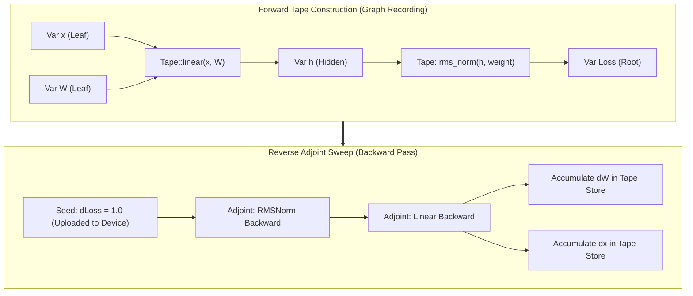
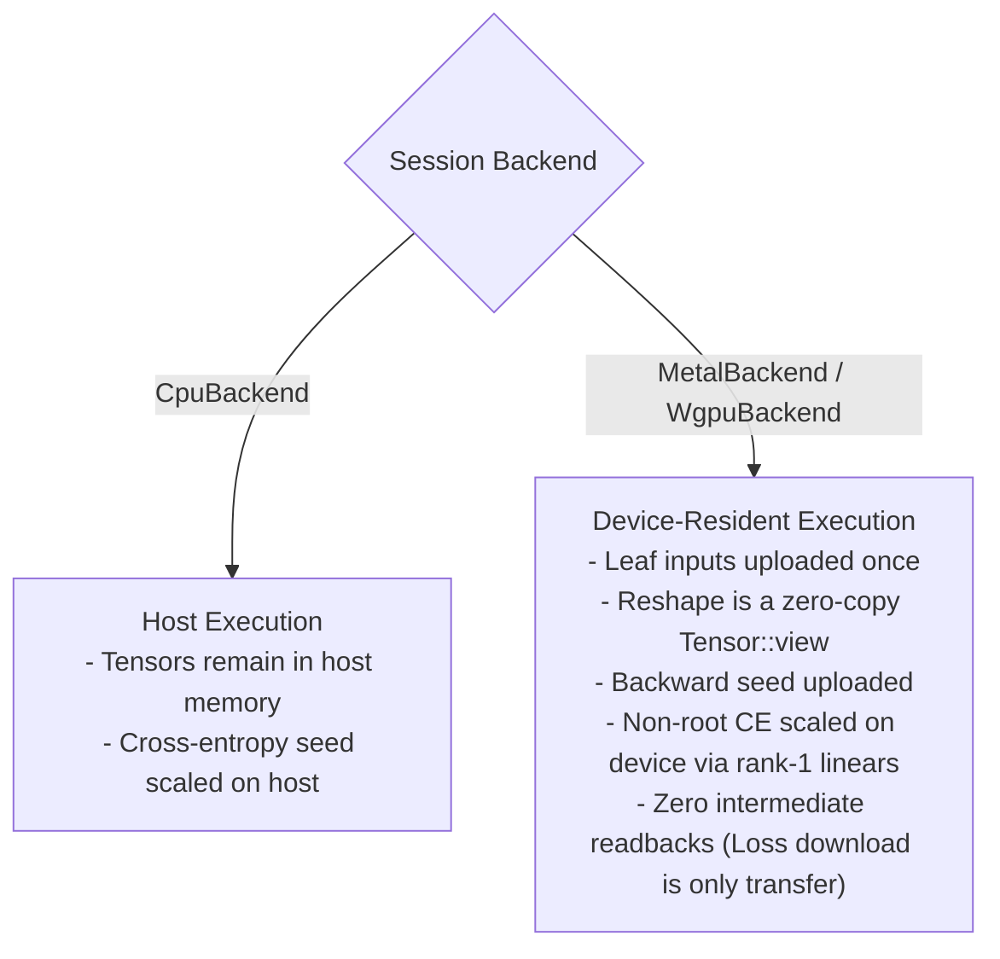
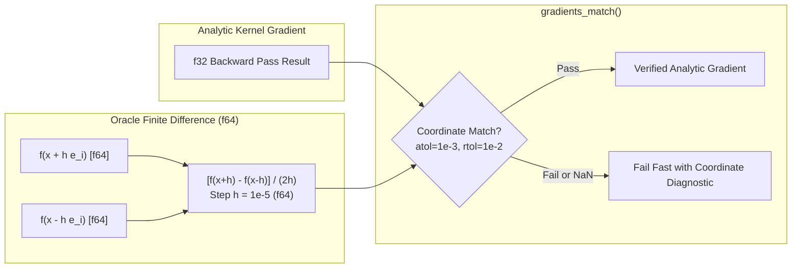

# ojas-autograd

`ojas-autograd` provides a dynamic reverse-mode automatic differentiation tape and an IEEE-754 `f64` numerical gradient verification oracle for the **ojas** deep learning framework.

It supports reverse-mode differentiation across CPU and GPU backends (`MetalBackend`, `WgpuBackend`) with device-resident gradient evaluation.

---

## Tape Graph & Reverse-Mode Adjoint Execution

---

## Multi-Backend Tape Execution & Device Residency

The autograd tape automatically adjusts its execution strategy depending on the underlying backend:

> [!NOTE]
> In `wgpu_tape`, `device_tape`, and `metal_tape` test suites, intermediate backward activations stay entirely in GPU memory. The loss download is the single audited readback from the device. On macOS, `metal_tape.rs` executes the seeded-backward G6 test suite on real Apple Silicon hardware.

---

## Supported Tape Operations

The dynamic reverse-mode tape records forward operations and evaluates analytical backward adjoints across backends:

| Operation | Tape Method | Adjoint Description |
| :--- | :--- | :--- |
| **Linear** | `Tape::linear` | $dX = dY \cdot W^T$, $dW = X^T \cdot dY$ |
| **Linear + Bias** | `Tape::linear_bias` | Simultaneous $dX, dW, db$. Bypasses $dW$ calculation when `weight` is frozen (`!needs_grad`). |
| **RMSNorm** | `Tape::rms_norm` | Normalized activations and weight scaling adjoints. |
| **LayerNorm** | `Tape::layer_norm` | Exact two-pass LayerNorm backward for activations, gamma, and beta. |
| **Channel LayerNorm** | `Tape::channel_layer_norm` | 2D LayerNorm backward over channel dimension $[B, C, H, W]$. |
| **GELU (erf)** | `Tape::gelu_erf` | Exact Gaussian error function and derivative backward (`gelu_erf_backward_exact`). |
| **Softmax** | `Tape::softmax` | Softmax adjoint $dX = S \odot (dY - \sum (dY \odot S))$ along dimension. |
| **Broadcast Add** | `Tape::broadcast_add` | Gradient passed to operands, reducing across broadcast dimensions. |
| **Broadcast Mul** | `Tape::broadcast_mul` | Scaled gradient passed to operands with reduction across broadcast dimensions. |
| **Scale** | `Tape::scale` | Scalar multiplication adjoint $dX = dY \cdot \alpha$. |
| **Attention** | `Tape::attention` | Causal and general attention adjoints (dQ, dK, dV, and optional score bias). |
| **Cross-Entropy** | `Tape::cross_entropy` | Target-excluded or fused chunked softmax cross-entropy adjoint. |

---

## Numerical Gradcheck Oracle (`central_diff`)

Every analytical gradient kernel is mathematically validated against an offline double-precision (`f64`) numerical oracle using central finite differences:

$$\frac{\partial f}{\partial x_i} \approx \frac{f(\mathbf{x} + h \mathbf{e}_i) - f(\mathbf{x} - h \mathbf{e}_i)}{2h}$$

---

## Safety Invariants & Defect Defenses

> [!IMPORTANT]
> 1. **Strict Double Precision (`f64`):** The numerical oracle computes in `f64` to prevent single-precision subtraction cancellation artifacts from masquerading as gradient discrepancies.
> 2. **Finite Step Size:** The finite difference step $h$ must be finite and strictly $> 0.0$.
> 3. **Coordinate-Wise NaN Detection:** Parity checks compare absolute and relative error across every single tensor element. Any coordinate producing `NaN` or non-finite differences fails immediately—**preventing false-positive passes from NaN fold operations**.
> 4. **Frozen Weight Bypass:** When parameters have `needs_grad = false` (e.g. frozen backbone weights), `Tape::linear_bias` bypasses allocating and computing the weight gradient adjoint $dW$, saving device memory and compute cycles.
> 5. **Shape Check on Accumulation:** `Tape::acc` returns an error when an accumulated gradient's shape differs from the forward value's, before anything is added.
