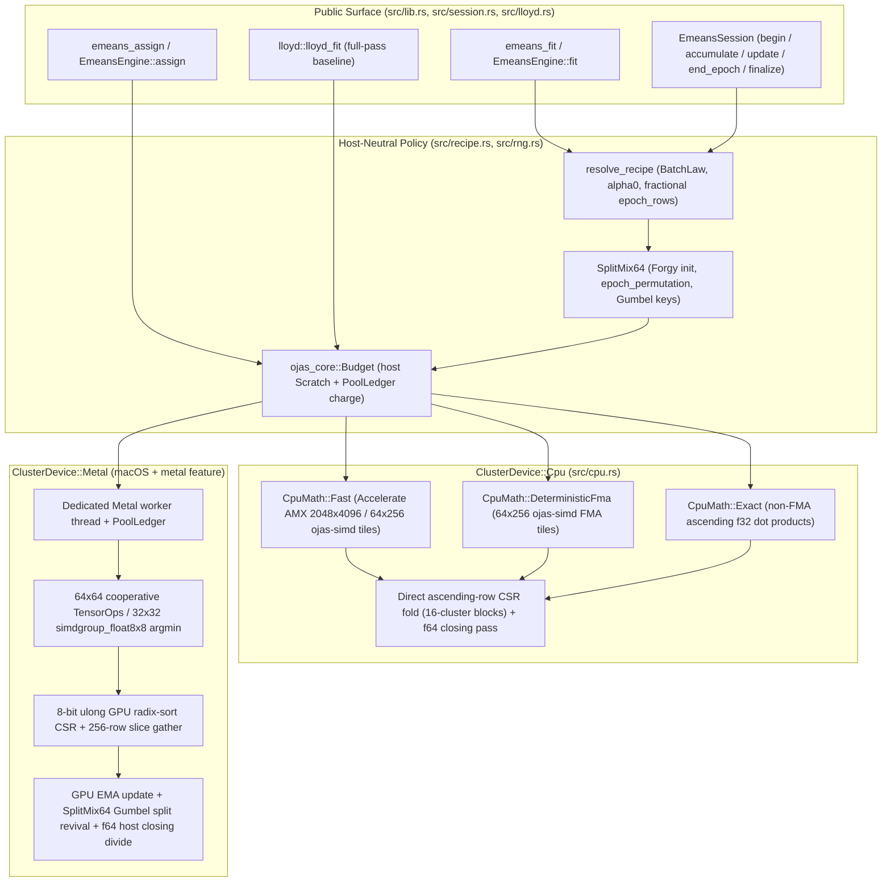

# ojas-cluster

`ojas-cluster` implements **scaling-law `e-means` clustering** (`canonical_v1`, [arXiv:2611.09501](https://arxiv.org/abs/2611.09501)) and a reference full-pass **Lloyd's $k$-means** baseline (`lloyd_fit`) for `ojas`. It executes over multi-core CPU SIMD/BLAS ([`ojas-simd`](../ojas-simd/README.md)) and Apple Silicon Metal 4 (`64x64` cooperative `TensorOps` and `32x32` `simdgroup_float8x8` kernels via [tessl](https://github.com/bharathvbcr/tessl)) behind a single safe-Rust engine and streaming session API (`#![forbid(unsafe_code)]`).

> [!NOTE]
> Following [`docs/modular-extensions.md`](../docs/modular-extensions.md), all generic clustering policy—`canonical_v1` scaling laws, cosine step decay, `SplitMix64` sampling and epoch permutations, `Budget` accounting, and streaming session state machines—lives once in `ojas-cluster`. When built on macOS with the default `metal` feature, `ClusterDevice::Metal` delegates GPU execution to a dedicated worker thread owning a private Metal 4 `GpuRuntime` and `EmeansGpuRunner` in `tessl`.

---

## Architecture & Dispatch



---

## `canonical_v1` Recipe & Algorithmic Mechanics

[`resolve_recipe`](src/recipe.rs) translates `(global_n, d, EmeansConfig)` into a [`ResolvedRecipe`](src/lib.rs) before any device memory is reserved:

1. **Subsampling (`max_points_per_centroid`):** When set to $m \ge 1$, [`sample_subset_sorted`](src/rng.rs) deterministically draws $n_{\text{eff}} = \min(n, m \cdot k)$ sorted row indices via partial Fisher-Yates over `SplitMix64`. Unsampled rows receive [`UNASSIGNED_LABEL`](src/lib.rs) (`u32::MAX`) when `capture_assignments` is enabled.
2. **Batch-Size Law (`BatchLaw`):** `BatchLaw::Auto` selects `Quality` ($C_B = 0.00439175$, capped at $\max(1, \lfloor n_{\text{eff}} / 2 \rfloor)$) when $d \le 16$, and `Throughput` ($C_B = 0.035134$, capped at $\text{round\_pow2}(n_{\text{eff}} / 2)$) when $d > 16$:

$$B_0 = \text{round\_pow2}\!\left(C_B \cdot k^{0.134749} \cdot n_{\text{eff}}^{0.876473} \cdot T^{0.813344}\right)$$

3. **Initial EMA Rate & Cosine Schedule:** Unless overridden via `EmeansConfig::alpha0`, the initial EMA rate $\alpha_0$ follows the empirical scaling law clamped to $[10^{-4}, 1.0]$ and decays over `total_steps` via [`scheduled_alpha`](src/recipe.rs):

$$\alpha_0 = \text{clamp}_{[10^{-4},\, 1.0]}\!\left(0.8244 \cdot k^{-0.4617} \cdot B^{0.9003} \cdot n_{\text{eff}}^{-0.4498} \cdot T^{-0.1057}\right)$$

$$\alpha(s) = \alpha_0 \cdot \left(0.1 + 0.9 \cdot \frac{1 + \cos(\pi \cdot \min(s, S) / \max(S, 1))}{2}\right)$$

4. **Fractional Epoch Schedule & Closing Pass:** For $T = \lfloor T \rfloor + f$ with $\lfloor T \rfloor \ge 1$, `epoch_rows` places any fractional remainder pass $\text{round\_ties\_even}(f \cdot n_{\text{eff}})$ **before** a full $n_{\text{eff}}$-row final epoch (for example, $T = 2.6$ on $n = 100{,}000$ executes `[100_000, 60_000, 100_000]`). During the final epoch, every batch accumulates closing sufficient statistics alongside EMA updates (`f64` `pass_sums` + `f64` divide on CPU; `f32` GPU slice/CSR `pass_sums` + `f64` host closing divide on Metal) so [`EmeansFit::centroids`](src/lib.rs) are finalized from the full closing pass, retaining the latest EMA centroid for any cluster with zero closing-pass assignments.
5. **EMA Update & Gumbel Dead-Cluster Split Revival:** Each mini-batch updates cluster usage $u_j \leftarrow (1 - \alpha) u_j + \alpha n_j$ (or $u_j \leftarrow \alpha n_j$ when $\alpha = 1$) and blends centroids with exact `weight == 1.0` replacement when $u_{\text{old}} = 0$. Every 5th mini-batch step (`CHECK_UNUSED_EVERY = 5`; `(step + 1) % 5 == 0` when `unused_threshold > 0.0`, i.e., 0-based `step` in $\{4, 9, 14, \dots\}$ or 1-based $s \equiv 0 \pmod 5$), clusters with $u_j < \tau \cdot \bar{u}$ ($\tau = 0.1$ for $d > 2$, $0.0$ for $d \le 2$) are revived by splitting live donor clusters ranked by stateless `SplitMix64` Gumbel keys $g_j = \ln(u_j) - \ln(-\ln U_j)$ with alternating $\pm\epsilon$ coordinate perturbations (`split_epsilon = 1e-4`), plus 1-ULP deterministic tie separation when `(1 +/- eps)` underflows representation precision.

---

## Execution Substrates & Precision Lanes

[`ClusterDevice`](src/lib.rs) never falls back silently across devices or features (`OjasError::Unsupported` when `ClusterDevice::Metal` is requested without macOS + `metal` or without a Metal 4 GPU):

| Substrate | Variant | Assignment Math | Accumulation & Closing Stats | Determinism Profile |
| :--- | :--- | :--- | :--- | :--- |
| CPU | `CpuMath::Fast` | Apple Accelerate AMX (`2048x4096` panels when unpinned on macOS) or `64x256` L2-tiled `ojas-simd::sgemm_tile` | Direct ascending-row CSR fold (`16`-cluster blocks; `f32` `batch_sums`, `f64` closing `pass_sums` + `f64` divide) | Deterministic per host/OS (`unique_centroid_hashes = 1` across repeated M5 Pro runs); Accelerate AMX may vary across OS/thread heuristics |
| CPU | `CpuMath::DeterministicFma` | `64x256` L2-tiled `ojas-simd::sgemm_tile` FMA micro-kernels (`ROW_TILE = 64, C_TILE = 256`) | Direct ascending-row CSR fold (`16`-cluster blocks; `f32` `batch_sums`, `f64` closing `pass_sums` + `f64` divide) | Bit-identical (`0` ULP) across arbitrary worker thread counts (`1..N`) |
| CPU | `CpuMath::Exact` | Non-FMA ascending-$d$ `f32` dot products over `ROW_TILE = 64` row tiles | Direct ascending-row CSR fold (`16`-cluster blocks; `f32` `batch_sums`, `f64` closing `pass_sums` + `f64` divide) | Bit-identical (`0` ULP) across thread counts and CPU microarchitectures |
| Metal 4 | `MetalPrecision::Bf16` | `64x64` 4-simdgroup `bf16` cooperative `TensorOps` (`32x32` `simdgroup_float8x8` fallback) | 8-bit `ulong` GPU radix-sort CSR + `256`-row slice gather & ascending slice fold of `bf16`-rounded rows into `f32` `batch_sums`/`pass_sums` + `f64` host closing divide | Bit-identical (`0` ULP) across repeated fits and [`EmeansSession`](src/session.rs) streaming vs resident `fit_with_init` on the same GPU (verified through $k = 1024$) |
| Metal 4 | `MetalPrecision::Bf16AssignF32Stats` | `64x64` 4-simdgroup `bf16` cooperative `TensorOps` (`32x32` `simdgroup_float8x8` fallback) | 8-bit `ulong` GPU radix-sort CSR + `256`-row slice gather & ascending slice fold of unrounded `f32` rows into `f32` `batch_sums`/`pass_sums` + `f64` host closing divide | Mixed-precision lane with `0`-ULP repeat-run and streaming-vs-resident bit-identity on the same GPU (verified through $k = 1024$) |
| Metal 4 | `MetalPrecision::F32` | `64x64` 4-simdgroup exact `f32` cooperative `TensorOps` (`RELAXED=false`; `32x32` `simdgroup_float8x8` fallback) | 8-bit `ulong` GPU radix-sort CSR + `256`-row slice gather & ascending slice fold of unrounded `f32` rows into `f32` `batch_sums`/`pass_sums` + `f64` host closing divide | Full `f32` pipeline with `0`-ULP repeat-run and streaming-vs-resident bit-identity on the same GPU (verified through $k = 1024$) |

> [!IMPORTANT]
> Every host scratch buffer (`Scratch<T>`) and Metal pool slab (`OjasBudgetLedger` -> `tessl::PoolLedger`) charges [`ojas_core::Budget`](../ojas-core/README.md) **before** allocation and refuses over-cap requests with `OjasError::CapacityExceeded` without mutating engine state or poisoning the GPU runtime. Dropping `EmeansSession` and `EmeansEngine` (or calling `EmeansEngine::trim_pool`) returns `Budget::live_bytes()` to `0`.

---

## Usage

### One-Shot Fit & Assignment

```rust
use ojas_cluster::{emeans_assign, ClusterDevice, CpuMath, EmeansConfig, EmeansEngine};
use ojas_core::{Budget, Tensor};

let budget = Budget::new(256 * 1024 * 1024);
let engine = EmeansEngine::new(
    ClusterDevice::Cpu {
        threads: None,
        math: CpuMath::DeterministicFma,
    },
    &budget,
)?;

let x = Tensor::from_f32(&rows, &[n, d], &budget)?;
let mut cfg = EmeansConfig::new(k);
cfg.nepochs = 2.6;
cfg.seed = 42;

let fit = engine.fit(&x, &cfg)?;
let (labels, total_obj) = engine.assign(
    &x,
    &fit.centroids,
    cfg.spherical,
    cfg.assignment_chunk_size,
)?;
let (_one_shot_labels, _one_shot_obj) =
    emeans_assign(&x, &fit.centroids, cfg.spherical, engine.device(), &budget)?;
```

### Out-of-Core Streaming (`EmeansSession`)

[`EmeansSession`](src/session.rs) accepts arbitrary `[m, d]` `F32` or `Bf16` (`Host` or `Mapped`) row chunks bounded by `1 <= m <= session.remaining_in_batch()`, returning `(AccumulateStep, Option<Vec<u32>>)` and producing a `0`-ULP bit-identical [`EmeansFit`](src/lib.rs) relative to `EmeansEngine::fit_with_init`:

```rust
use ojas_cluster::EmeansSession;

let mut session = EmeansSession::begin(&engine, global_n, &init_centroids, &cfg)?;
let num_epochs = session.recipe().epoch_rows.len();
while session.epoch() < num_epochs {
    while session.remaining_in_epoch() > 0 {
        while session.remaining_in_batch() > 0 {
            let take = next_chunk_len.min(session.remaining_in_batch());
            let (step, _maybe_closing_labels) = session.accumulate(&next_chunk(take))?;
            if step.batch_ready {
                let _revived = session.update()?;
            }
        }
    }
    let _stat = session.end_epoch()?;
}
let fit = session.finalize()?;
```

---

## Apple M5 Pro Benchmark (`e-means` vs 25-Iter Lloyd)

Measured by [`examples/emeans_bench.rs`](examples/emeans_bench.rs) against `tessl @ 17471e7` (1 untimed warmup + 5 cyclic-interleaved paired rounds per shape on Apple M5 Pro, macOS 27.2, `rustc 1.99.1`, 18 CPU pool threads; full raw output and load disclosure in [`bench/results/2026-11-10-emeans`](../bench/results/2026-11-10-emeans/README.md)). All 9 contenders start from identical Forgy `init_centroids`, produce `0`-ULP identical centroid bits across all 6 runs (`unique_centroid_hashes = 1`), and are scored by exact `f64` Euclidean MSE $\frac{1}{n}\sum_i \min_j \|x_i - c_j\|_2^2$:

| Shape | Contender | `min_ms` | `median_ms` | `MSE (f64)` | `MSE vs Lloyd` | `speedup_min` | `speedup_med` |
| :--- | :--- | ---: | ---: | ---: | ---: | ---: | ---: |
| `100k x 128, k=1024` | `Lloyd 25-iter (CpuMath::Fast)` | 4005.60 | 4327.02 | 0.228053 | +0.00% | 1.00x | 1.00x |
| `100k x 128, k=1024` | `e-means T=2.0 (CpuMath::Fast)` | 376.94 | 387.35 | 0.170040 | -25.44% | 10.63x | 11.17x |
| `100k x 128, k=1024` | `e-means T=2.6 (CpuMath::Fast)` | 500.20 | 520.05 | 0.160376 | -29.68% | 8.01x | 8.32x |
| `100k x 128, k=1024` | `e-means T=2.0 (Metal::F32)` | 48.62 | 63.99 | 0.169943 | -25.48% | 82.39x | 67.62x |
| `100k x 128, k=1024` | `e-means T=2.6 (Metal::F32)` | 47.98 | 65.84 | 0.162137 | -28.90% | 83.49x | 65.72x |
| `100k x 128, k=1024` | `e-means T=2.0 (Metal::Bf16AssignF32Stats)` | 49.78 | 65.71 | 0.165726 | -27.33% | 80.46x | 65.85x |
| `100k x 128, k=1024` | `e-means T=2.6 (Metal::Bf16AssignF32Stats)` | 47.30 | 58.95 | 0.160264 | -29.73% | 84.69x | 73.40x |
| `100k x 128, k=1024` | `e-means T=2.0 (Metal::Bf16)` | 44.16 | 59.26 | 0.172521 | -24.35% | 90.72x | 73.01x |
| `100k x 128, k=1024` | `e-means T=2.6 (Metal::Bf16)` | 46.30 | 57.74 | 0.163665 | -28.23% | 86.52x | 74.94x |
| `65.5k x 512, k=1024` | `Lloyd 25-iter (CpuMath::Fast)` | 4052.29 | 4766.71 | 0.248275 | +0.00% | 1.00x | 1.00x |
| `65.5k x 512, k=1024` | `e-means T=2.0 (CpuMath::Fast)` | 428.62 | 572.35 | 0.197876 | -20.30% | 9.45x | 8.33x |
| `65.5k x 512, k=1024` | `e-means T=2.6 (CpuMath::Fast)` | 501.02 | 545.76 | 0.179865 | -27.55% | 8.09x | 8.73x |
| `65.5k x 512, k=1024` | `e-means T=2.0 (Metal::F32)` | 87.66 | 108.06 | 0.192224 | -22.58% | 46.23x | 44.11x |
| `65.5k x 512, k=1024` | `e-means T=2.6 (Metal::F32)` | 92.23 | 93.54 | 0.178966 | -27.92% | 43.94x | 50.96x |
| `65.5k x 512, k=1024` | `e-means T=2.0 (Metal::Bf16AssignF32Stats)` | 101.69 | 118.72 | 0.199768 | -19.54% | 39.85x | 40.15x |
| `65.5k x 512, k=1024` | `e-means T=2.6 (Metal::Bf16AssignF32Stats)` | 95.90 | 116.23 | 0.181201 | -27.02% | 42.26x | 41.01x |
| `65.5k x 512, k=1024` | `e-means T=2.0 (Metal::Bf16)` | 88.49 | 95.96 | 0.193460 | -22.08% | 45.79x | 49.67x |
| `65.5k x 512, k=1024` | `e-means T=2.6 (Metal::Bf16)` | 86.84 | 103.19 | 0.183158 | -26.23% | 46.67x | 46.19x |

---

## Test Suites (23 integration tests)

- [`tests/recipe_and_rng.rs`](tests/recipe_and_rng.rs) (5 tests): `canonical_v1` batch-law resolution against upstream Python values, fractional epoch ordering and invalid-bound refusals (including `k >= UNASSIGNED_LABEL`), `SplitMix64` sampling/permutations and spherical prescaling, and collapsed-split 1-ULP separation across `-0.0`, subnormals, and finite extremes.
- [`tests/cpu_and_lloyd.rs`](tests/cpu_and_lloyd.rs) (9 tests): `CpuMath::DeterministicFma` and `CpuMath::Exact` multi-thread bit-identity and thread-ceiling refusal, pinned-thread vs Accelerate panel parity, `f64` closing-pass accumulation without `f32` stall, spherical zero-row/unassigned edge cases, `e-means` `T = 2.6` vs 25-iter `lloyd_fit` convergence, and fail-closed non-finite/overflow/`u32`-bound/`Budget` refusals.
- [`tests/metal_and_session.rs`](tests/metal_and_session.rs) (9 tests): `faiss/contrib/e_means` `canonical_v1` golden parity across CPU and all three Metal precision lanes, resident `fit` vs streaming `EmeansSession` bit-identity, `k = 1024` multi-epoch Gumbel revival repeat-run and streaming-vs-resident `0`-ULP bit-identity across all three Metal 4 precision lanes, near-`f32::MAX` Euclidean Metal-vs-CPU parity and `NonFinite` recovery, fresh-engine tight-`Budget` upload staging reclaim, cross-runtime `Mapped` (`SharedBuf`) zero-copy safety and `Budget` trim recovery without `GpuRuntime` poison, 200-iteration engine reuse and early-drop zero-leak checks, and dtype/state-machine/`UNASSIGNED_LABEL` refusals.
