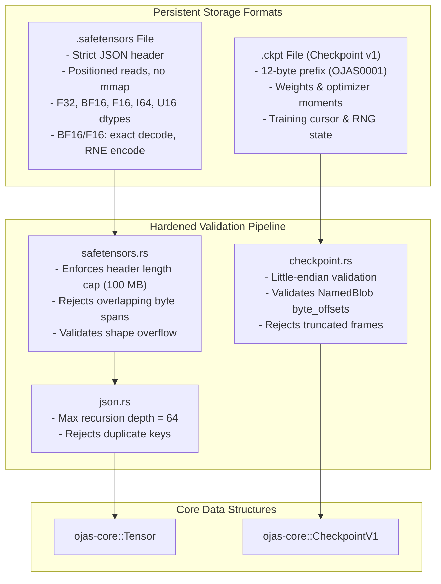
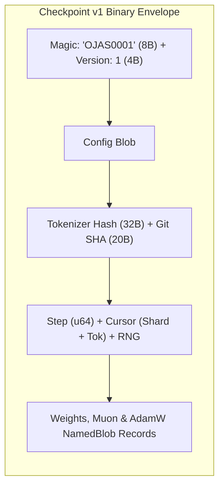

# ojas-io

`ojas-io` provides serialization and deserialization routines for **safetensors** model files and binary **Checkpoint v1** containers, hardened against malicious payloads, corrupted headers, and integer overflow attacks.

It also holds the workspace's other small format code, so no crate carries a copy: the strict JSON reader's compact writer (`JsonValue::render`, `JsonObj`, `quote`; a non-finite float is written as the string `"NaN"`, `"inf"` or `"-inf"`, never as a number) and the `.npy` golden reader (`npy`: little-endian `<f4`, `<f8`, `<i8`, C order, versions 1.0 to 3.0; anything else is refused by name).

---

## Formats & Parsing Engine

---

## Reading tensors into caller storage

`SafeTensors::open` reads the header only; `info`, `read_into` and `read_bytes` already look one tensor up by name. Three additions let a loader land the bytes where it wants them, with no decode and no intermediate buffer:

- `read_tensor_into(name, dst)` fills a `&mut [u8]` of exactly the tensor's length with one positioned read. A short or long destination is refused before a byte is written.
- `read_into_slab(names, align, slab)` reads a list of tensors into one caller-held slice, each at an `align`-aligned address (`align` is a power of two up to `MAX_SLAB_ALIGN`). The slice may have any alignment: each slot is rounded up from its real address, so an unaligned slab costs up to `align - 1` bytes at the front. `slab_len(names, align)` is the size from an aligned start. The whole plan (names, repeats, alignment, total size) is checked before the first read, so a slab that is too small is refused untouched.
- `read_into_sink` takes any `TensorSink` (for example a page-aligned pool slab) and re-checks every slot's length and alignment before reading into it. `OwnedSlab` is an aligned slab charged to a `Budget` before it is allocated and released on drop.

The bytes land as stored, little-endian, and are bit-equal to `read_bytes` of the same tensor. None of this uses `unsafe`.

---

## Binary Checkpoint v1 Record Structure

---

## Safety Invariants & Hardening Guarantees

> [!IMPORTANT]
> 1. **Header Length Enforcement:** Safetensors header sizes are capped at 100,000,000 bytes (`MAX_HEADER_BYTES`) to prevent memory exhaustion from crafted denial-of-service headers.
> 2. **Duplicate Key Rejection:** Any JSON or safetensors header containing duplicate parameter identifiers is refused with an `IoError` ("duplicate key"). The streaming `SafeTensorsWriter` refuses duplicate tensor names and metadata keys before it writes a byte.
> 3. **Non-Overlapping Range Validation:** Tensor byte spans inside safetensors files must not overlap. Overlapping spans are rejected to eliminate memory alias vulnerabilities.
> 4. **Shape Overflow Detection:** If the product of dimension sizes overflows `usize` or `u64`, decoding halts before memory allocation.
> 5. **JSON Recursion Boundary:** JSON parsing is hard-limited to a maximum recursion depth of 64, preventing stack overflow from deeply nested payloads.
> 6. **Truncation Defense:** Checkpoint files truncated before an expected field boundary return an `IoError` ("truncated checkpoint")—**never zero-padding missing data**.
