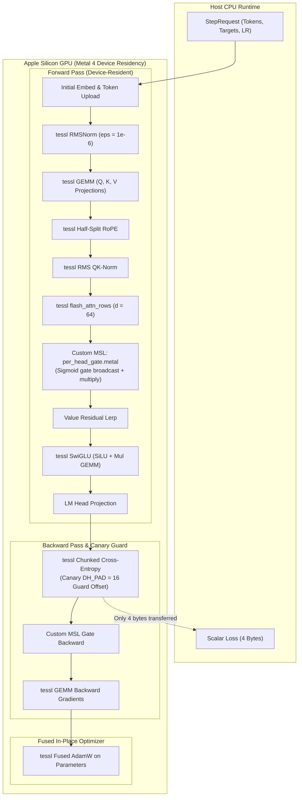
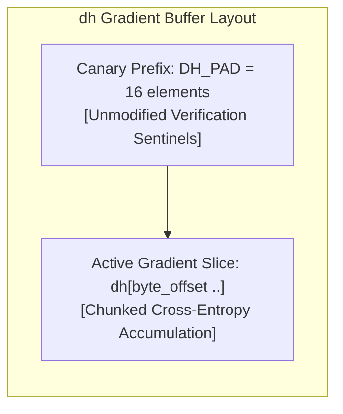
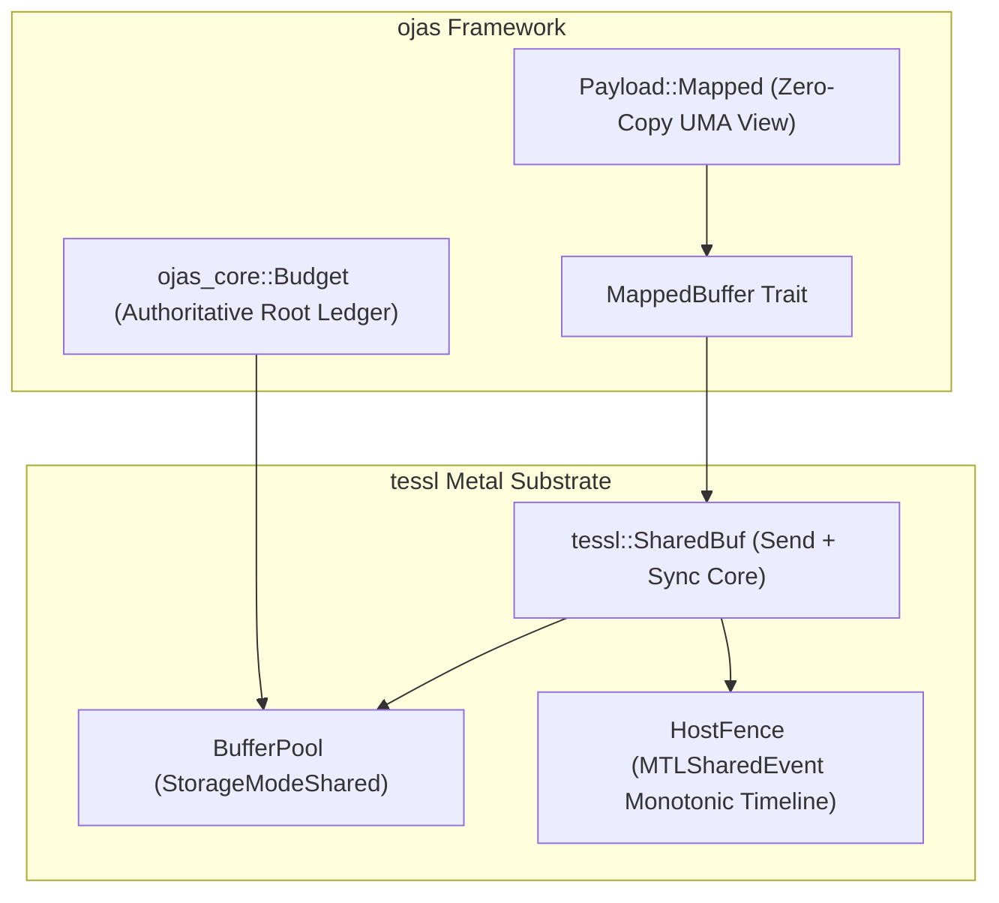

# ojas-metal

`ojas-metal` provides the native Apple Silicon GPU backend for **ojas**, executing the full deep learning training pipeline and inference directly on Apple M-series chips via **Metal 4**.

It bridges high-throughput GEMM, normalization, and flash-attention kernels from `tessl` with custom MSL (Metal Shading Language) shaders for attention output gating.

---

## Metal Execution & Memory Residency

Tensors remain device-resident across the entire forward, backward, and optimizer cycle, reading back only the final scalar loss (4 bytes) or greedy logits (8 bytes) to host memory:

---

## Hardware Shaders & Custom MSL

### 1. Per-Head Attention Gate (`kernels/per_head_gate.metal`)
Nanolab default GPT applies a linear gate with bias followed by sigmoid modulation to scale attention heads. `ojas-metal` implements dedicated Metal shaders:
* **Forward Kernel:** Computes $g = \sigma(x W_g + b_g)$ and evaluates $y = \text{attn} \odot g$, folding input (`ST_IN` on `attn` and `bias`) and output (`ST_OUT` on `pre` and `out`) finiteness checks in-kernel.
* **Backward Kernel:** Computes analytic adjoint gradients $\frac{\partial \mathcal{L}}{\partial \text{attn}}$ and $\frac{\partial \mathcal{L}}{\partial W_g}$ on the device with in-kernel `ST_IN`/`ST_OUT` finiteness checks.

### 2. Backend Extension Shaders (`kernels/ojas_backend.metal`)
Implements elementwise operations, vector arithmetic, and reduction passes required by `ojas_core::Backend`, plus:
* **`permute`** (`ojas_permute`, `ojas_permute_runs`, `ojas_permute_tile`): a device-resident, bit-exact axis reorder up to rank 8, planned by `src/permute.rs`.
  * `ojas_permute_runs` runs row copies when the innermost contiguous run is a multiple of 16 floats (e.g. attention head swaps, window split/merge when `window * C` is a multiple of 16, identity floor).
  * `ojas_permute_tile` uses a 32x32 shared-memory tile for 2-D transposes and NCHW/NHWC moves. Both kernels fuse the finite check into memory reads.
  * `ojas_permute` serves as the general fallback.
* **General attention** (`attention_forward`, `attention_forward_saving`, `attention_backward`):
  * Plain unmasked self-attention ($T_q = T_k$) at D=32 and D=64 routes to `tessl encoder_attn` between permutes (e.g. 22.8 vs 606 ms at `[1, 16, 5184, 64]`), unless `bf16_accumulation()` is enabled (in which case it runs on `ojas-metal`'s `bf16`-accumulating attention kernels).
  * Decoupled cross-attention ($T_q \ne T_k$) at D=32 and D=64 with at least `flash_min_groups()` threadgroups runs the native TensorOps flash kernels (`ojas_attn_fwd_d32` and `ojas_attn_fwd_d64`) in one dispatch without $O(m^2)$ pad-q zero-padding ($34.5\times$ speedup over scalar on $5184 \times 5200$ memory cross-attention: `6.06 ms` vs `209.28 ms`).
  * Additive logit bias (`boxRPB`) at D=32 and D=64 is accumulated directly into tile score registers (`buffers 13..18`, bit 2 of `window_and_flags`) before online softmax when launching at least `flash_min_groups()` threadgroups ($14.1\times$ speedup on DETR cross-attention: `0.85 ms` vs `11.98 ms`).
  * Short queries (fewer than `flash_min_groups()` threadgroups) and head dim 16 run split-K tiled kernels (`ojas_xattn_part_dD`, `ojas_xattn_combine_dD`), splitting key ranges across threadgroups to saturate the GPU.
  * General shapes, windowing, and causal cross-attention fall back to scalar `ojas_attn_gen_fwd` (one simdgroup per row, D ≤ 256).
  * Backward (`ojas_attn_gen_bwd_{dq,dkv,dbias}_d*` and `ojas_attn_bwd_dr`) computes `dQ`, `dK`, `dV`, and optional broadcast `dBias` on the device.
* **Spatial operators**:
  * `conv2d_forward` & `conv2d_backward`: arbitrary stride and padding using `ojas_im2col` scratch followed by tessl NT GEMM and `ojas_conv_nchw`; depthwise convolution (`groups == in == out`) runs the direct single-pass kernel `ojas_dwconv`.
  * **1x1 Stride-1 Unpadded Route:** When `kernel == 1`, `stride == 1`, `padding == 0`, `dilation == 1`, and `groups == 1`, `conv2d_forward` skips `im2col` scratch generation entirely and routes directly to tessl NN GEMM per image with no intermediate layout pass ($2.03\times$ speedup on f32, $2.1\times$ on bf16-exact at $[1, 256, 288, 288]$).
  * **BF16 GEMM Lane Selection:** `conv2d_forward` selects the bf16 GEMM lane (`Link::lane`) when operands are bf16-exact.
  * `conv_transpose2d_forward` & `conv_transpose2d_backward`: (kernel == stride) executed via `ojas_permute` to NHWC, tessl NN GEMM, and `ojas_convt_nchw`.
  * `max_pool2d_forward` & `max_pool2d_backward`: `max_pool2d_fwd` with row-major first-occurrence tie-breaking; `max_pool2d_bwd` window inverse gather with zero atomics, preserving signed zero `-0.0` values.
  * `interpolate_bilinear_forward`: `ojas_bilinear` computes taps directly in the shader for both `align_corners` modes with zero axis-table allocations.
  * `rope_interleaved_forward` / `_backward`: adjacent-pair rotation on `ojas_rope` mode 2, matching CPU axial 2D tables.
* **Gemma embedding operators (`kernels/gemma_ops.metal`)**:
  * `gelu_tanh_forward` & `gelu_tanh_backward`: `ojas_gelu_tanh_fwd` and `ojas_gelu_tanh_bwd` evaluating exact tanh GELU via analytical sigmoid in `f64` with hardware status word trapping (`GEMMA_ST_IN`, `GEMMA_ST_OUT`).
  * `seq_mean_forward`: ragged sequence mean pooling using `ojas_segments_from_lens` on GPU (and `ojas_seq_mean_fwd` under `bf16_accumulation`).
  * `l2_normalize_forward` & `l2_normalize_backward`: L2 vector normalization with epsilon stabilization, Matryoshka dimension prefix slicing, and analytical backward (`ojas_l2_normalize_fwd` / `ojas_l2_normalize_bwd`).
  * `rms_qkv_norm_forward`: weightless per-head RMSNorm across Q, K, and V heads.
  * Non-causal sliding window attention ($|i - j| \le W$) with dual routing (tiled SIMD vs scalar) across head dimensions $D \in \{32, 64, 256, 512\}$.
* **Vision & encoder operators (`kernels/ojas_backend.metal`, `kernels/encoder_bwd.metal`)**:
  * `group_norm_forward`: three passes (`ojas_gn_sum`, `ojas_gn_sq`, `ojas_gn_apply`) splitting rows into up to 512 threadgroups per row; uses large-mean residual correction for numerical precision.
  * `layer_norm_forward` & `layer_norm_backward`, `channel_layer_norm_forward` & `channel_layer_norm_backward`: forward routed to tessl BERT layer norm (or `ojas_ln_fwd` under `bf16_accumulation`; channel norm composed with permutes); backward on `ojas_ln_bwd_rows`, `ojas_ln_bwd_cols_part`, `ojas_cln_bwd_pos`, `ojas_cln_bwd_ch_part`, and `ojas_cols_fin4`.
  * `gelu_erf_forward` & `gelu_erf_backward`: forward routed to tessl BERT `bias_gelu_erf`; backward on `ojas_gelu_erf_bwd`.
  * `relu_forward`: `ojas_relu_fwd` (bit-identical to CPU).
  * `concat`, `slice` & `fill`: device-resident memory assembly (`ojas_concat_part`, `ojas_slice` with full-input finite scan, `ojas_fill_words`). Filled U32 tensors carry `Ids::Below(value + 1)` bounds.
  * `linear_bias_forward` & `linear_bias_backward`, `broadcast_add_backward` & `broadcast_mul_backward`, `softmax_forward` & `softmax_backward`: GEMM + broadcast add/mul and `ojas_bcast_grad_{part,fin}` reductions; `ojas_softmax_rows` and `ojas_softmax_bwd_rows`.
* **AdamW** (`ojas_adamw_check`, `ojas_adamw_apply`): torch's single-tensor step in tessl's f32 arithmetic, with scalars from `ojas_core::check_adamw`. The step is in place and needs no scratch.
  * The check kernel decides the whole step: inputs and every new p, m and v must be finite.
  * The apply kernel, in the same command buffer, writes only if this call's status words are clear. A refused step leaves all three tensors bit-identical and is reported at the next sync point.
  * No wait, and no copies.
* **RMSNorm** (`ojas_rms_fwd`, `ojas_rms_bwd_rows`, `ojas_rms_bwd_w_{part,sum}`): one simdgroup per row.
  * The weight gradient is a two-stage, fixed-order reduction (64-row partials, then a sum per column), so it is deterministic.
  * Input (`ST_IN`) and output (`ST_OUT`) finiteness checks are folded directly into the compute kernels for non-empty shapes (`rows > 0 && dim > 0`), with degenerate shapes falling back to explicit `Worker::check` passes.
* **In-kernel finiteness folding & vectorized `float4` fault/accumulate kernels**:
  * In addition to RMSNorm, Per-Head Gate, and Cross-Entropy, input/output finiteness checks (`ST_IN`/`ST_OUT` with `ST_IN` precedence preserved) are folded into LayerNorm (`ojas_ln_fwd`, `ojas_ln_bwd_rows`, `ojas_ln_bwd_wb_sum`), RoPE (`ojas_rope_fwd`, `ojas_rope_bwd`, with explicit fallback when `(rows / heads) < time` or `rotary < dim` on full-width tables), and FlashAttention (`attn_fwd_tiled_body` output/LSE checks, `ojas_attn_bwd_dr` full `dout`/`o`/`lse` input scans).
  * Standalone finiteness scans (`Worker::check`) and in-place gradient additions (`Worker::accum`) dispatch vectorized `float4` kernels (`ojas_check_finite_v4`, `ojas_add_inplace_v4`) when buffer offsets and element counts are 4-float aligned.
* **Cross-entropy** (`ojas_ce_fused`): two passes per row (an online max/sum, then the gradient) instead of five.
  * The input and output finiteness checks are folded into those passes. Every element is still checked, including rows whose target is ignored.
  * Collapsed rows where $p_t - 1$ rounds to 0 take the target-excluded cross-entropy form; standard rows pay zero extra passes via a uniform branch.
* **Gradient accumulation** (`ojas_acc_check`, `ojas_acc_apply`): `accumulate_grad` adds in place, with no new memory, when `acc` solely owns its buffer, and is checked as AdamW is.
  * A non-finite input or sum is refused at the next sync point and leaves `acc`'s values bit-identical.
  * A shared `acc` gets a new buffer (holding the old values if the sum was refused); the other handles keep the old values.
* **Linear cross-entropy** (`ojas_lce_stats`, `ojas_lce_loss`, `ojas_lce_grad`, `ojas_add_into`): `linear_cross_entropy_mean` never holds more than one `[rows, cols]` logits tile.
  * tessl GEMMs make each tile, and a running (max, sum of exp) per row is merged across vocabulary tiles.
  * Carries the target-excluded sum and takes its form on collapsed rows, avoiding precision collapse on highly confident logits.
  * With gradients, a second pass remakes each tile (or, when one vocabulary tile covers V, reuses the tile the first pass left), turns it into the gradient of the logits, and adds both gradient GEMMs into the outputs.
  * The loss equals the unfused composition's. Gradients that the chunk does not split are bit-equal; split ones differ in summation order only.
* **KV cache** (`ojas_kv_write`, `ojas_cached_attn`):
  * `kv_cache_write` copies `[B, Tn, Hkv, D]` into a time-major `[B, Tcap, Hkv, D]` cache in place, only if the source is finite. A range error is refused on the host, before any dispatch.
  * `cached_attention_forward` is grouped-query causal attention of `Tq` queries against the first `kv_len` positions, one 1,024-thread threadgroup per (query, head).
  * A call with fewer than about 96 such threadgroups, such as one decode request, walks the cache in up to 96 / rows splits of at least 64 keys. `ojas_cached_attn_merge` then combines them in a fixed order, so results still repeat bit for bit. One request at 1024 keys runs about 22% less GPU time (`bench/results/2026-10-04-split/`).
  * Positions at or past `kv_len` are not read.
* **QK-norm** validates and places both pairs first, so a refused call records nothing. It then runs as one command when q's and k's outputs and scratch fit the budget together; otherwise it runs the two `rms_norm_*` calls, which hold one side's scratch at a time.
* **Causal attention** (`ojas_attn_fwd_d*`, `ojas_attn_bwd_dr` and `ojas_attn_bwd_{dq,dkv}_d*`, at head dims 16, 32, 64, 128 and 256): FlashAttention-2 on the TensorOps matrix units (MetalPerformancePrimitives `matmul2d`), after tessl's `qwen35_attn_tiled.metal` and `qwen35_attn_bwd.metal`. Grouped-query heads read their KV head in place: the forward and dQ index KV head `h / (Hq / Hkv)`, and dK/dV run one threadgroup per KV head that loops its query heads in a fixed order. Nothing is repeated or summed back.
  * The forward is one dispatch with an online softmax. It writes the output and the row log-sum-exp.
  * The backward takes the saved output and log-sum-exp and is three dispatches: `rowsum(dO * O)`, dQ, then dK/dV. Its only scratch is that row sum, `B * Hq * T` floats.
  * An optional sliding window `W` (query `t` sees keys `t - W < j <= t`) skips whole key tiles before the window and masks inside the edge tile.
  * Each threadgroup rebuilds 32 x 32 score blocks in about 8 KiB of threadgroup memory, so nothing T x T is stored.
  * Every output row is written once with no atomics, so results repeat bit for bit.
  * A `[T, D]` plane must fit i32 extents.
* **Qwen3.5 hybrid-layer ops** (`tests/hybrid.rs`, against the CPU within 1e-5 of each tensor's peak):
  * `causal_conv1d_silu_*` runs tessl's `qwen35::conv1d_silu` from a zero state and `qwen35_bwd::conv1d_silu_bwd` (or `ojas_conv1d_silu_{fwd,bwd_dx,bwd_dw}` + `ojas_rms_bwd_w_sum` under `bf16_accumulation`), whose weight gradient is a fixed-order sum of 256-row partials (`CONV1D_BWD_ROWS = 256`). Widths other than 2 to 8 are `Unsupported`.
  * `gated_rms_norm_*` runs tessl's `qwen35::gated_rms_norm` and `gated_rms_norm_bwd` (or `ojas_gated_rms_{fwd,bwd_rows,bwd_part}` + `ojas_rms_bwd_w_sum` with `GATED_RMS_BWD_ROWS = 64` under `bf16_accumulation`) with one head per row. The backward takes rows of at most 512 values; a wider row is `Unsupported`.
  * `rope_partial_*` runs `ojas_rope` with a rotary width: the leading `R` values of each head turn and the rest are copied bit for bit. At `R = D` it is `rope_half_split`, bit for bit.
  * tessl's kernels take a buffer and a column window, not a byte offset, so an operand that does not start its buffer is copied first. Every operand and output is checked for non-finite values, and a fault is deferred as for the other ops.
  * `MetalBackend::freeze_checked` (opt-in, Metal-only) scans a frozen parameter once and marks its buffer, so matmuls, gathers and the fused head skip their per-use finite scan; in-place writers refuse a marked buffer. See `docs/metal-deferred-faults.md` §3.1.
  * `sigmoid_*` (`ojas_sigmoid_fwd/bwd`) and `gdn_log_decay_*` (`ojas_gdn_decay_fwd`, `ojas_gdn_decay_bwd`, `ojas_gdn_decay_bwd_sum`) are ojas's own elementwise kernels; the softplus is tessl's `qwen35_softplus`, copied (a series below -3, where `log(1 + e^x)` loses most of the value). The `A_log` and `dt_bias` gradients are one thread per head summing the rows in ascending order. They bind operands at any byte offset, check their own operands and outputs, and defer a fault as the other elementwise kernels do.
  * `chunked_gdn_*` runs tessl's `gdn_train` (`tests/gdn.rs`). With the gates above these make up a linear-attention layer on the tape (`ojas-model/tests/metal_hybrid_tape.rs`), and the whole Qwen3.5 tower runs natively on Metal (`ojas-model/tests/qwen35_metal_tape.rs` on tessl's fixture against transformers; `ojas-qwen35/tests/gpu_tape_2b.rs` on the real 2B).

### 3. Opt-In Step-by-Step `bf16` Accumulation (`with_bf16_accumulation`)
By default, `MetalBackend` sums and accumulates in `f32`. Callers can opt into step-by-step IEEE-754 round-to-nearest-even `bf16` accumulation (`ojas_bf16`) via `MetalBackend::with_bf16_accumulation(true)` or `MetalBackend::set_bf16_accumulation(true)` (inspected via `bf16_accumulation()` and preserved across `with_budget`):
* **GEMM & Linear:** `ojas_gemm_bf16_accum` (`linear_forward`, `linear_backward`, `linear_backward_input`, `linear_bias_forward`, `linear_bias_backward`, `bmm`, `muon_ns5_step`, `linear_cross_entropy_mean`, `per_head_sigmoid_gate_*`, and `conv2d` im2col/pointwise and `conv_transpose2d` GEMM stages).
* **Convolutions:** `ojas_dwconv`, `ojas_conv_nchw`, `ojas_convt_nchw`, `ojas_col2im`, `ojas_dwconv_bwd_x`, `ojas_dwconv_bwd_w`, `ojas_chan_sum`, and `ojas_conv1d_silu_{fwd,bwd_dx,bwd_dw}`.
* **Attention & Per-Head Gate:** `ojas_attn_fwd_d{16,32,64,128,256}`, `ojas_attn_bwd_dr`, `ojas_attn_bwd_{dq,dkv}_d*`, `ojas_attn_gen_fwd`, `ojas_attn_gen_bwd_{dq,dkv,dbias}_d*`, `ojas_xattn_part_d{16,32}`, `ojas_xattn_combine_d{16,32}`, `ojas_cached_attn`, `ojas_cached_attn_merge`, `ojas_per_head_gate_bwd`, `ojas_per_head_gate_bwd_saved`, and `ojas_per_head_gate_dbias`.
* **Norms (Forward & Backward):** `ojas_rms_fwd`, `ojas_rms_bwd_rows`, `ojas_rms_bwd_w_part`, `ojas_rms_bwd_w_sum`, `ojas_ln_fwd`, `ojas_ln_bwd_rows`, `ojas_ln_bwd_cols_part`, `ojas_cln_bwd_pos`, `ojas_cln_bwd_ch_part`, `ojas_cols_fin4`, `ojas_gn_sum`, `ojas_gn_sq`, `ojas_gn_apply`, `ojas_gated_rms_fwd`, `ojas_gated_rms_bwd_rows`, and `ojas_gated_rms_bwd_part`.
* **Reductions, Softmax, Cross-Entropy, Pooling, Interpolate & Elementwise Sums:** `ojas_reduce_partial` and `ojas_reduce_final` (`value_residual_blend_backward`, `cross_entropy_mean_forward`, `linear_cross_entropy_mean`, `muon_ns5_step`), `ojas_seq_mean_fwd`, `ojas_l2_normalize_fwd`, `ojas_l2_normalize_bwd`, `ojas_softmax_rows`, `ojas_softmax_bwd_rows`, `ojas_ce_fused`, `ojas_lce_stats`, `ojas_max_pool2d_bwd`, `ojas_bilinear`, `ojas_embed_gather`, `ojas_bcast_grad_part`, `ojas_bcast_grad_fin`, `ojas_bcast_binary`, `ojas_add_fwd`, `ojas_add_into`, `ojas_acc_check`, `ojas_acc_apply`, and `ojas_gdn_decay_bwd_sum`.
* Verified in `tests/bf16_accumulation.rs` (12 suites covering every op, `Bf16` storage operands, `AutocastMode::Bf16`, multi-chunk reductions, and deferred `OjasError::NonFinite` faults).

---

## Cross-Entropy Canary Offset Defense

> [!CAUTION]
> Legacy Metal implementations frequently overwrite memory preceding a buffer slice because internal kernels forcibly assume an offset of zero (`Cols::dense`). 
> 
> `ojas-metal` reserves `DH_PAD = 16` padding elements before the `dh` slice and rigorously verifies in test `ce_nonzero_dh_offset_keeps_prefix` that the leading prefix remains bit-identical after cross-entropy writes.

---

## Unified HAL & Tessl Runtime Integration

`ojas-metal` acts as the Metal extension adapter bridging `ojas-core`'s unified memory abstractions to `tessl`:

* **Zero-Copy Host/GPU Sharing (`Payload::Mapped`):** `tessl::SharedBuf` implements `ojas_core::MappedBuffer`. Tensors wrap shared Metal allocations directly with no memory copying across CPU and Apple Silicon GPU. On `Backend::upload`, `Worker::upload` downcasts `Payload::Mapped` (`SharedBuf`) and calls `SharedBuf::to_gpu_buffer()` to adopt the unified memory buffer directly into the device buffer table with zero byte copies (`mem_after == mem_before`).
* **Lease Fencing & Mutex Protection:** Host reads (`host_read`) and writes (`host_write`) obtain fenced leases that synchronize with GPU timeline stamps (`last_use`, `last_write`), rejecting concurrent GPU execution while host leases are live.
* **`BudgetTrimHandler` Cache Eviction & Pool Ledger Refusal:** `ojas-metal` connects `ojas_core::Budget` to `tessl`'s buffer pool (`BudgetLedger` in `Worker::open`). Under allocation pressure, the budget triggers freelist cache trimming across the unified pool, and pool capacity refusals map directly to `OjasError::CapacityExceeded`.
* **Structural Dead Code Elimination:** 3,735 lines of redundant, unverified `gpu.rs` code were retired from `ojas-metal`. All device memory allocations, command buffers, and kernel pipelines are managed via `tessl` under the authoritative root `Budget`.

---

## Key Invariants & Refusal Policies

> [!IMPORTANT]
> 0. **Shape First** (`docs/shape-contract.md`): every op calls its `ojas_core::shapes` validator before placement, contiguity, token-id ranges, device limits or the budget, so a malformed call returns the validator's exact error whatever the budget holds and wherever its operands live. `tests/shape_first.rs` sweeps every op in four modes (Budget 0, a cap that holds only the inputs, a NaN operand, host operands).
> 1. **Strict Head Dimension Refusal:** `MetalBackend` refuses $d_{\text{head}} > 256$ (`ojas_core::METAL_MAX_HEAD_DIM`) with `Err(OjasError::UnsupportedHeadDim)`—never silently clamping or dropping high-index features. The attention kernels are compiled up to 256. The cap is a device limit, checked after the shape validator. Grouped-query causal SDPA repeats KV heads into that kernel and sums the KV gradients.
> 2. **AdamW Step Counter Safety:** Step increments use checked integer math. When `step` reaches `u64::MAX`, the kernel halts with an error instead of wrapping to zero.
> 3. **Device Residency Invariant:** No intermediate activations or gradients are downloaded to the host during `Step`. Only the 4-byte scalar loss is read back.
> 4. **Deferred Faults** (`docs/metal-deferred-faults.md`): an op whose kernels find a NaN or infinity returns `Ok`; the next `sync`, `download` or `clip_grad_norm` on the backend returns `OjasError::NonFinite` naming the first such op in recording order, once. Shape, dtype, placement, capacity, head-dim, range and token-id refusals stay immediate. Ops are recorded into one command buffer and wait only at those sync points, at reads and uploads made while work is recorded, and at memory and status-slab caps.
> 5. **Memory Cap (`set_mem_cap`/`mem_cap`):** the cap is the bytes allocated since the last waited commit at which the backend commits and waits. A lower cap trades resident memory for more waited commits; lowering it below the bytes already allocated, with work recorded, waits for one commit. A zero or over-budget cap is refused and leaves the cap unchanged, and the resource plan sets aside the uncharged `mem_cap` bytes (`tests/mem_cap_setter.rs`).
